# TamaPoke

[](https://codester00.github.io/TamaPokeLAN/web/)
[](https://makerworld.com/es/models/2937822-tamapoke-a-pokemon-pokeball-tamagotchi)


[](https://github.com/DylanPDao/TamaPoke/stargazers)

A gen-1-Pokémon-inspired tamagotchi for the
**Waveshare ESP32-S3-Touch-AMOLED-1.75** (round 466×466 AMOLED, CO5300 driver
over QSPI, CST9217 touch over I2C). Raise any of the 1025, evolve it, train it
and complete them all (shinies included).

> ### 🙏 This is a fork of a fork of a fork: [**socquique/TamaPoke**](https://github.com/socquique/TamaPoke) → [**DylanPDao/TamaPoke**](https://github.com/DylanPDao/TamaPoke) → here
>
> Quique Tortosa wrote the original TamaPoke — the firmware, the sprite
> pipeline, the six-language UI, the web installer, the whole thing. Dylan Dao
> forked and extended it (Kalos/Alola, several real-hardware save-corruption
> fixes). This fork builds on both; it did not start any of it. If you like
> this, go star **[the original](https://github.com/socquique/TamaPoke)** and
> **[Dylan's fork](https://github.com/DylanPDao/TamaPoke)**.
>
> Original: MIT © 2026 Quique Tortosa. Changes in this fork and in Dylan's are
> MIT on the same terms.

> **Personal, non-commercial fan project.** Code is MIT; the sprites are from
> PMD SpriteCollab (CC BY-NC, Pokémon © Nintendo/Game Freak), and the 3D case is
> CC BY-NC-SA. See **[License](#license)** and **Credits**.

🔴 **3D-printed Pokéball case + print profiles → [on MakerWorld](https://makerworld.com/es/models/2937822-tamapoke-a-pokemon-pokeball-tamagotchi)** · flash it in your browser → **[web installer](https://codester00.github.io/TamaPokeLAN/web/)**

## Status

Running on hardware. Implemented: 1025 species + shinies animated from microSD, full
life cycle (egg by rarity → evolution → farewell/release/runaway, each gated
behind a decision dialog), bred-Pokédex with gallery, turn-based trainer, wild
and LAN battles, **wild capture and a shared bag**, battle stats (IVs +
training), retention hooks (streak / bond / medals / name), biome + real-time
backgrounds, **ten training games**, animated bath, RTC with offline
progression, battery (AXP2101) and PWR button, anti-burn-in dimming,
**sound (ES8311)**, **6 UI languages (English default)**, **starter choice on
first run**, and a one-click **web installer**.

All nine regions are in the dex, each with its own sprite pack in the web
installer. A region whose pack is not on the card shows as NEEDS PACK and stays
out of the egg pool until it is — the same gating every region has always used.

**Added in this fork:**

- **LAN battles are fully working now** — scan for and battle another player
  head-to-head over WiFi Direct (no router or home WiFi needed!), with
  win/loss records kept per rival.
- **Trading** — swap a party or box creature one-for-one with another board,
  over the same radio as LAN battles. Built so a dropped connection or a flat
  battery mid-trade never loses a creature; see § Trading below. Trades have
  been done between real boards; the dropped-connection recovery has so far
  only been exercised in the emulator.
- **Ten training games** (v3.34) — pick a game from a list instead of a fixed
  stat; some train one stat, some split the same points across two, and three
  raise joy and bond instead. § Actions has every rule.
- **Kinder care rules** (v3.34) — walk away from a fully cared-for creature
  for **8 hours** and it will be hungry and tired but unpunished; petting wears
  off until you play with it; a daytime **nap** ends by itself so a child can
  put it to bed and go to school. § The four stats and § Actions.
- **The Poké Mart** — spend real steps, turned into Pokédollars, on balls,
  potions and vitamins between EXPLORE and the gyms.
- **A pedometer** drives it, with no extra battery draw — the QMI8658's own
  onboard step-counting engine never worked reliably on this board, so
  steps are detected from the same accelerometer readings instead.
- **`tools/debugger/`** — a live serial monitor + save editor for testing
  against real hardware. Not part of the firmware itself.

## Screens

All shots are straight off the 466x466 round panel, rendered headlessly by the
emulator (`tools/emu/tamapoke-emu --shot <name>`), so they are exactly what the
hardware draws.

### Starting out

| Pick a region | ...then its starter | Johto's three |
|---|---|---|
|  |  |  |

A new game asks which region you are playing before it asks which creature you
want. The choice sets both: you pick from that region's three starters, and it
becomes where your eggs come from afterwards (changeable later on the egg's
region pill). Existing saves never see this screen — it only appears when the
Pokédex is empty.

### Raising one

| Your creature | Its egg | Moves it knows |
|---|---|---|
|  |  |  |

The egg carries a **region pill** — pick which of the nine regions it hatches
from, or ALL for the mixed pool. Switching keeps the rarity it was granted and
remembers each region's answer, so it cannot be flipped to farm a legendary.
Regions with no sprite pack installed are skipped rather than offered.

### Battling

| The fight | Choosing a move | Choosing a team | Winning |
|---|---|---|---|
| 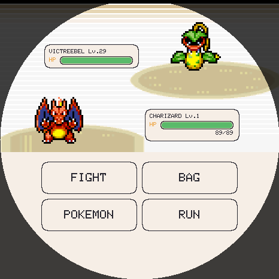 | 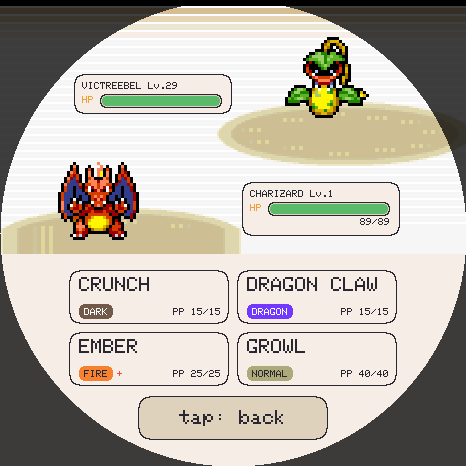 |  | 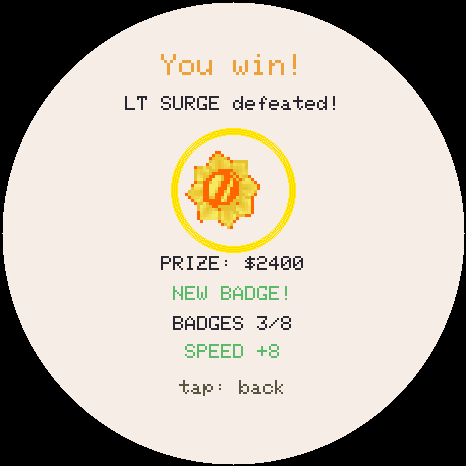 |

Turn- and move-based, with the real type chart, ailments and STAB. Moves sit in a
2x2 grid with each one's type and remaining uses. Real Game Boy battle music
plays throughout.

### Nine gym ladders

| Pick a ladder | Johto's gyms | LAN battle |
|---|---|---|
| 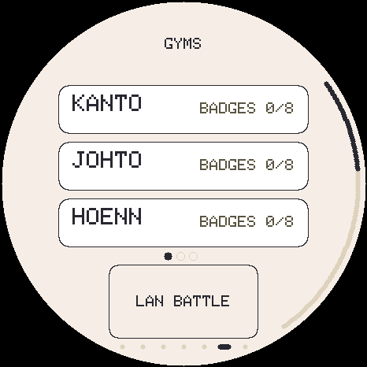 | 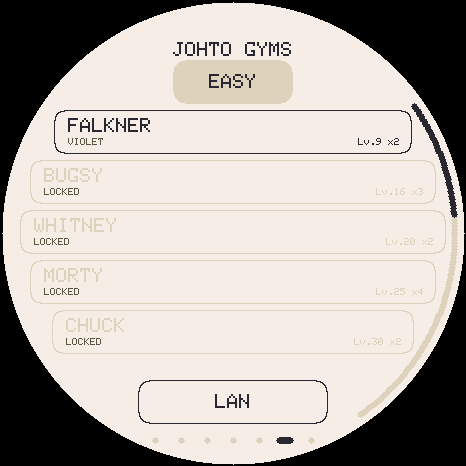 | 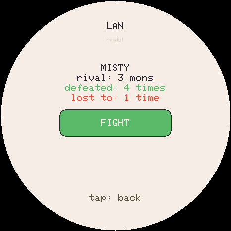 |

Every region has eight leaders, an Elite 4 and a champion, on easy and hard.
Four of the nine are the games' own
teams, checked against the pokecrystal, pokeemerald and pokeplatinum
disassemblies — **0 differences across all 39 verified trainers**, re-checkable
with `tools/verify_rosters.py`.

**Unova, Kalos, Alola, Galar and Paldea are the exceptions, and say so.** pret's
work stops at the DS generation, so those five ladders are written from knowledge rather than
from the games' own tables; `verify_rosters.py` prints each of them as NOT
VERIFIED rather than letting a clean run imply otherwise. Unova follows Black 2 /
White 2, which unlike Black/White has no version- or starter-dependent leaders.

Galar follows **Sword** (Bea and Gordie, not Shield's Allister and Melony), and
since Galar has no Elite Four its four Elite slots are the Champion Cup —
Marnie, then Nessa, Bea and Raihan with their stronger teams — before Leon.
Paldea is Scarlet/Violet as played, Larry appearing twice just as he does there.
Where a leader's creature has no sprite art it is swapped for a close stand-in of
the same type, so no fight opens on a bare dex number; `trainers.h` lists each.

Sinnoh follows **Platinum**, where Fantina is the *third* gym rather than
Diamond/Pearl's fifth; the level ramp only runs 14/22/26/32/37/41/44/50 that
way. Same reasoning that makes Hoenn Emerald throughout.

### Exploring

| Choose where to hunt | Kanto's areas | A wild encounter |
|---|---|---|
| 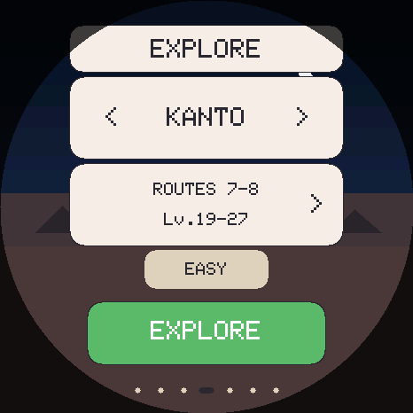 | 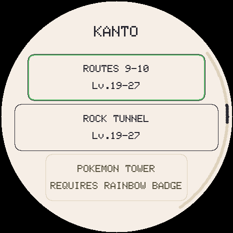 | 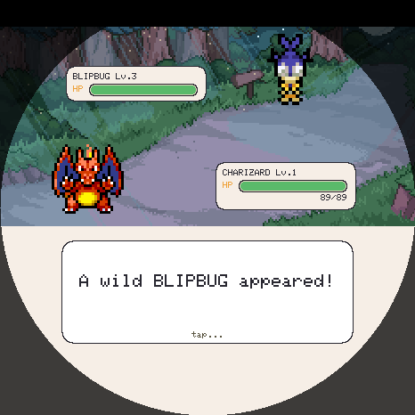 |

Wild creatures are met by exploring rather than only in gyms. The `< REGION >`
selector picks where the next encounter comes from, independently of your egg's
region, so changing hunting grounds never rerolls or moves the egg. Regions whose
sprite pack is not installed are skipped. **Kanto and Johto are split into the
games' own areas** -- Route 1, Mt. Moon and Cerulean Cave; Route 29, Ilex Forest
and the Whirl Islands; 71 in all -- each holding the creatures the games put
there, and each opening with the badge that opened it in the games. Tap the area
row to choose one; a locked area says which badge it needs, and a starred one
has a legendary waiting. Weaken one and throw a ball to keep it;
a caught creature goes to the party or the box, and does *not* fill the Pokédex
until you actually raise it.

### The Poké Mart

| The catalogue | Buying something |
|---|---|
| 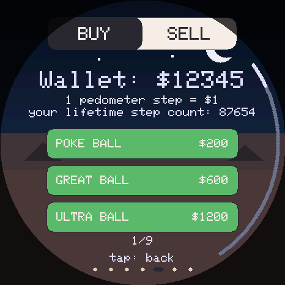 | 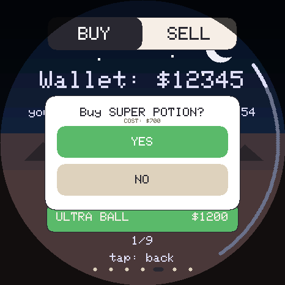 |

Sits between EXPLORE and the gyms on the tile axis. Real steps become
Pokédollars at 1:1 — see § Game manual below for the wallet cap and price list.

### Training

| The games | Rock Smash | Block! | Tilt Maze |
|---|---|---|---|
| 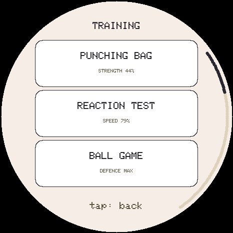 | 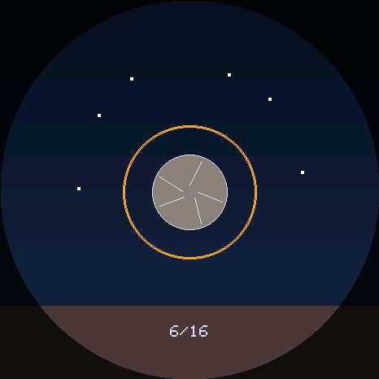 | 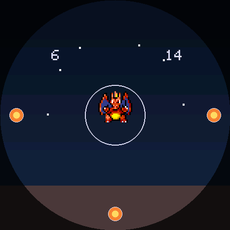 | 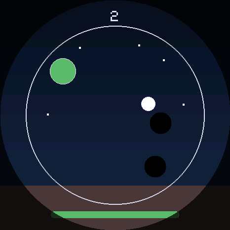 |
| **Boulder Push** | **Memory** | **Hide and Seek** | |
| 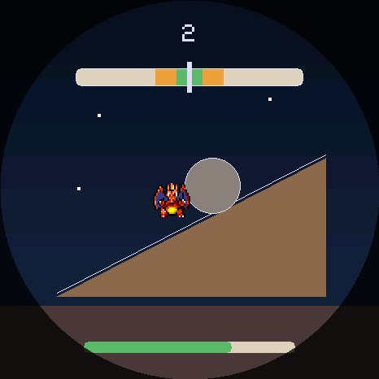 | 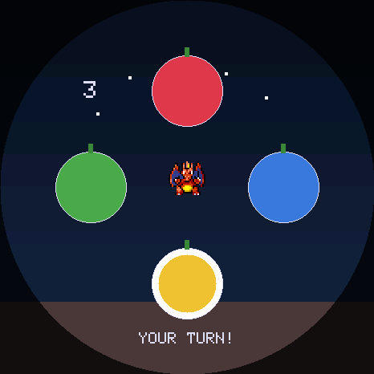 | 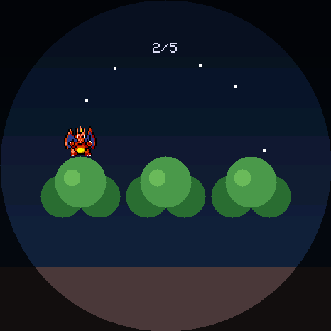 | |

The dumbbell opens a list of games, each naming the stats it raises and how far
along they are. Some train one stat, some split the same points across two, and
Berry Catch raises joy and bond instead — see § Actions below.

### Trading

| Choosing a trade | When the connection drops |
|---|---|
| 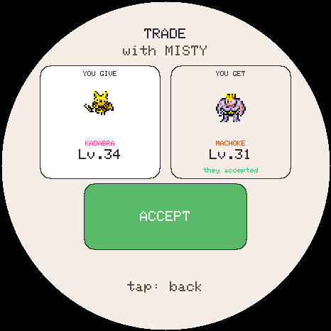 | 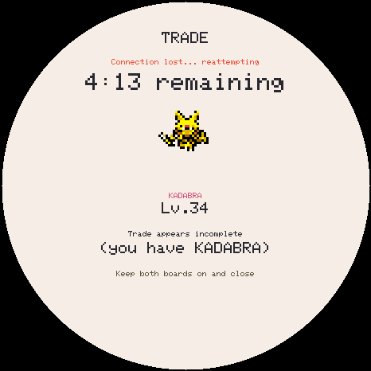 |

One creature for one, from the LAN screen's **TRADE** button. If the boards lose
each other mid-trade, each screen says what its board holds and counts down
while it keeps trying — see § Trading in the manual below.

### Collecting

| Pick a region | Kanto | Johto |
|---|---|---|
| 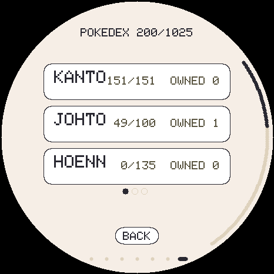 | 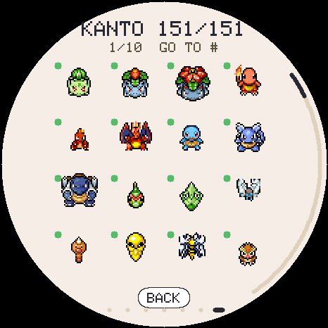 | 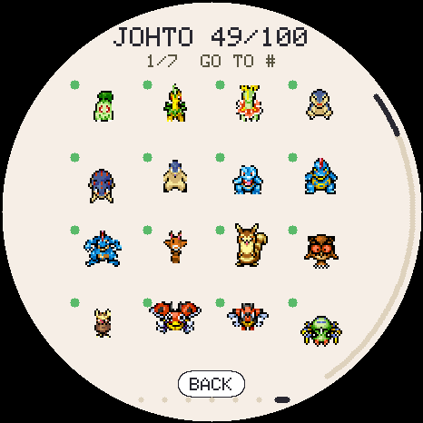 |

| Trainer card | Johto badges | The box |
|---|---|---|
| 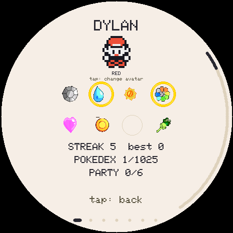 | 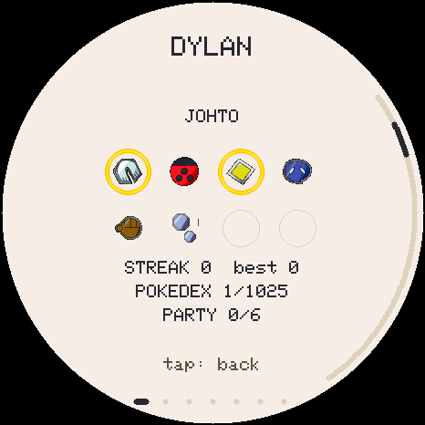 |  |

| Choose your look | More trainers | Blacked out |
|---|---|---|
| 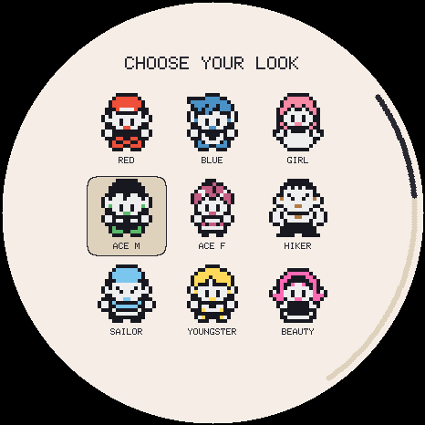 | 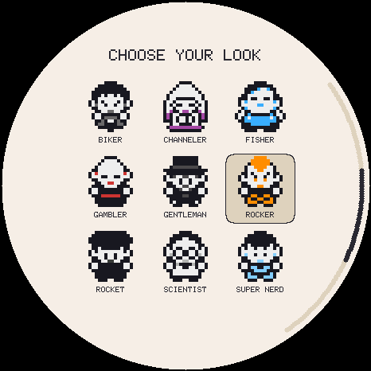 | 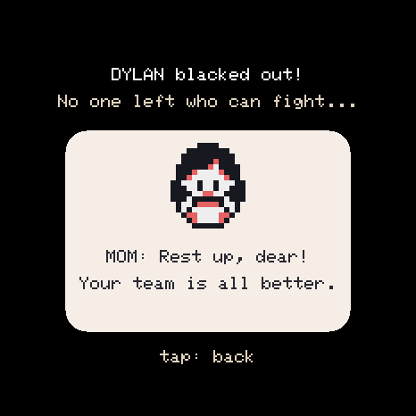 |

## Game manual (the actual numbers)

A quick reference to how the game really works (values straight from the code).

### Controls

The round panel has no corners to anchor a back button, so touch gestures carry
the navigation — three axes, one meaning each, everywhere:

| Gesture | Means |
|---|---|
| **Horizontal swipe** | move along the **tile axis**: `PLAYER · PARTY · [PET] · EXPLORE · MART · GYM · POKÉDEX`. It **bumps** at both ends and never closes anything. |
| **Swipe up** | go **deeper** — from the pet, its stat card |
| **Swipe down** | go **back**, one level, from anywhere |
| **Drag the rim** | **page** whatever is in front of you (the arc scrollbar at 2–5 o'clock) |

- **Tap the name** at the top opens the **menu** (Pokédex / Bag / Settings).
- **Tap the creature** to pet it. **Long press (3 s)** opens the **release**
  dialog — gated to the main screen only, so it can never fire on a party slot.
- **Physical PWR button:** short press = screen on/off · long press (4 s) =
  full power-off (the RTC keeps running, so time still passes while it's off).

### Time & leveling

- **1 real minute = 1 in-game minute.** Your Pokémon gains **+1 level every hour**
  of real time. Leveling is purely time-based — caring well doesn't speed it up,
  but neglect *delays evolution*.
- **Level caps at 100**, reached at 4 days 3 hours. Farewell is only *offered* at
  3 days (level 73) — **not a deadline**: your Pokémon is still growing, and
  declining it to reach 100 is a real choice. Declining re-offers a day later.
- It keeps **aging while powered off** (the RTC runs), catching up to **2 weeks** max.

### The four stats (0–100)

Needs: **FOOD**, **JOY**, **ENE** (energy), **HYG** (hygiene). Start 80 / 80 / 80 / 100.

**The rule (v3.34): you can walk away from a topped-up creature for 8 hours**,
screen on and awake, and come back to one that is hungry, tired and wants
attention — but has not been penalised. Past 8 hours, neglect counts.

While **awake**:

| Stat | Drain | Notes |
|---|---|---|
| FOOD | **−1 every 6 min** (10/h) | |
| ENE | **−1 every 6 min** (10/h) | twice that if out of shape (fitness < 50 → sluggish) |
| HYG | **−1 every 8 min** (7.5/h) | **4/h more per poop** on screen (max 3 poops) |
| JOY | **−1 every 6 min** (10/h) | **5/h more** if FOOD < 30, and 5/h more if HYG < 30 |

- **~1 %/min** chance to poop while FOOD > 40 — about one every 100 minutes.
- **The 8-hour grace window.** It starts when the creature is **fully cared
  for — all four needs at 90 or more** — and counts awake minutes from there.
  A single snack, bath or game does **not** restart it, and neither does
  petting: only getting every need back above 90 does (a care action while it
  is already fully cared for counts too, so a creature kept topped up all day
  never runs out of window). Sleep and time with the board switched off don't
  count. Inside the window no need drops below **15**. From full, 8 hours
  leaves it around FOOD 20 / ENE 20 / JOY 15 / HYG 15. Energy only comes back
  with rest, so a full top-up usually means a nap.
- **Past 8 hours** the needs fall to 0. A **care slip-up** is any need at **≤ 10**
  (counted at most once an hour); each one **delays evolution by 1 level** and
  cools the bond by 1. An hour at **zero on everything** makes it ready to
  **run away** — roughly 13 hours untended from full.
- **Fitness** (shown on the card, 0–99) starts at **75**, and next to it the
  creature's **weight in kg**: its real Pokédex weight at fitness 75, **1% lighter
  per point above, 1% heavier per point below** — so at most 24% under, at worst
  75% over. A Snorlax (460 kg in the Pokédex) ranges from 349.6 kg at fitness 99
  to 805 kg at 0. Fitness rises by itself, **+1 every 9 min** awake and **+1 every
  27 min** asleep, up to **99**; while the board is **switched off** it rises no
  higher than **85**. Below **50** the energy drain doubles, and below **40** the
  creature is described as chubby.

### Actions

- 🍎 **Berry** (3 flavors): +25 FOOD, −3 fitness. Each species has a **hidden
  favorite flavor** → +35 FOOD, +10 JOY, only −1 fitness, ♥, bond, and it gets
  revealed.
- 🍬 **Candy:** +10 FOOD, +12 JOY, but **−12 fitness** (fattening).
- 🏋️ **Training menu** (the dumbbell): a list of **games**, each row naming
  what it raises and how far along those stats already are. A session pays at
  most **18 training points**; a game that trains **two** stats splits them
  evenly (9 + 9), so it's the same total, divided. Leaving a game early keeps what
  you earned. A game restarts the 8-hour window only if it leaves every need at
  90 or more.
  - 🥊 **Punching bag** — **STRENGTH** (~4 hits = 1 pt), tires it. +1 fitness
    per 10 hits (max +4).
  - 🎯 **Reaction test** — **SPEED**: tap the target before it shrinks away; the
    window tightens as you go. +1 fitness per 10 hits (max +4).
  - ⚽ **Ball game** — **DEFENCE** (2 rallies = 1 pt), plus a little joy
    (**+3, +1 per 2 rallies**, max +13). +1 fitness per 5 rallies (max +4).
  - 🪨 **Rock Smash** — **STRENGTH + SPEED**: a ring closes on a rock 16 times,
    a little faster each beat (1.1 s down to 0.65 s). Tap as it lands: within
    **0.09 s is PERFECT** (2), within **0.18 s GOOD** (1). All 16 perfect is a
    full session (9 + 9). A tap well ahead of the ring is ignored; one aimed
    at it but early spends the beat.
  - 🛡️ **Block!** — **DEFENCE + SPEED**: for 20 s attacks fly at your creature
    from the four sides (one every 1.1 s, down to 0.5 s; never two down one
    side). Tap that side to block. Tapping a side with nothing on it wobbles
    the shield for 0.4 s, so hammering every side doesn't work. **20 blocks**
    is a full session.
  - 🌀 **Tilt Maze** — **SPEED + DEFENCE**: tilt the board to roll a ball into
    the green goal, around two holes (a hole sends it back to the middle). 30 s,
    **3 points per goal**. Whatever angle you hold the board at when it starts
    counts as level. Needs the board's motion sensor.

  - 🪨 **Boulder Push** — **STRENGTH + DEFENCE**: a needle swings across a power
    bar (one swing every ~1.9 s at first, ~1.2 s by the end). Tap while it's in the **green** to shove the
    boulder up the slope 2 steps (**yellow**: 1). Tap outside the middle and it
    **slips back** a step and won't budge for 0.35 s, so mashing gets nowhere.
    **45 steps** is a full session; a perfect round is about 54.

    All four cost what any training does: −10 energy, −5 food, +4 joy, bond,
    and +1 fitness per 5 points (max +4). A round that earned nothing costs
    nothing.
  - 🍓 **Berry Catch** — **JOY + BOND**: drag the basket for 20 s, catch berries,
    dodge rocks (dark, with a red cross: one in the basket costs a point and
    flashes −1; a miss costs nothing). Pays **+6 joy, +2
    per berry** (max **+30**) and **+1 bond per 8 berries** (+1 to +3), and makes
    petting fresh again.
  - 🧠 **Memory** — **JOY + BOND**: four berries light up in a sequence; tap
    them back in the same order. Each round adds one, up to 12; a wrong berry
    ends it. Scores **2 per berry** of your longest run.
  - 🌳 **Hide and Seek** — **JOY + BOND**: your creature hides in one of three
    bushes, the bushes shuffle (more swaps, faster, each round), and you point
    at where it went. 5 rounds, **5 per find**.

    Memory and Hide and Seek pay like Berry Catch (**+6 joy** for playing, then
    2 per point to **+30**; bond **+1 per 8 points**, max +3), and make petting
    fresh again — even a round with nothing found pays the +6.

    Joy stops at 100 and bond rises at most **20 a day**, so a game can pay
    nothing: the result then reads **JOY MAX** or **BOND MAX TODAY** instead of
    +0. A training stat at its ceiling reads **MAX** the same way.
- 🫧 **Bath:** clears poops, HYG → 100.
- 👆 **Pet it:** wears off. Each tap gives **+10, +8, +6, +4, +2, then 0** JOY
  (and +1 bond while it still gives joy), until a joy/bond game (Berry Catch)
  makes it fresh again. Petting restarts the 8-hour window only if it is what
  brings the last need up to 90.
- 🌙 **Sleep:** rest — ENE **+6/min**, FOOD and JOY fall **1 every 18 min**
  and HYG **1 every 24 min**, with floors (FOOD 30 / JOY 35 / HYG 45). Sleep
  doesn't count toward the 8-hour window. No poops, no slip-ups, can't run away while
  asleep. **Screen off between midnight and 06:00 puts it to sleep**, and it
  stays asleep until you turn the screen back on — it wakes when *you* do, not
  at a fixed hour. The light button always overrides the screen.
- 💤 **Naps (light button, 06:00–18:00):** a daytime bed is a **nap**, and the
  creature **gets up by itself once fully rested** (from tired, about
  15 minutes) — so you can put it down and go to school.
  - **Fed, bathed and happy, just tired:** it wakes fully cared for, which
    starts a fresh **8-hour window**. You come home to a hungry, tired, dirty
    creature that is awake and glad to see you, with no slip-ups.
  - **Put down hungry, dirty or unhappy:** it still wakes when rested, and the
    nap **changes nothing about the 8-hour window**. With 3 hours of it left,
    it wakes with those same 3 hours, and slip-ups count once they run out. A
    window that was already over stays over: a nap is not a top-up.
  - **Bed after 18:00 is bedtime:** it sleeps until you wake it, whatever the
    clock says. With the clock never set there's no daytime, so a bed by hand
    is always bedtime.

### Eggs & who you get (spawn odds)

- Hatch the egg: tap it **3×** (or wait — it hatches on its own).
- Every later egg rolls a **rarity tier** (over the ~79 base forms that come from eggs):

| Tier | Base chance | After a proper goodbye | # species |
|---|---|---|---|
| ✨ Legendary | ~3 %\* | ~10 % | 5 |
| 🔵 Rare | ~27 % | ~45 % | 27 |
| ⚪ Common | the rest | the rest | 47 |

  \* Legendaries only start appearing once you've **registered ≥ 25** Pokémon.
- A daily **streak** and high **bond** push rare/legendary odds higher.
- A clean **goodbye blesses** the next egg; a **run-away curses** it (forces Common).
- Within a tier it favors species whose **evolution line you haven't finished** (so
  all 1025 are completable).
- **Shiny:** base **1 / 48** (→ **1 / 24** right after a goodbye), improved by
  streak/bond down to a best of **1 / 8**. Tracked separately in the dex.
- Every hatch rolls unique **IVs** (see below) — no two are identical.

### Evolution and moves

- Triggers when **level ≥ its evolution level** (16 for most base forms; ~25
  for friendship-style like GOLBAT → CROBAT, ~30 for stone-style) **and every
  stat ≥ 40** at that moment.
- **Trade evolutions happen only by trading**, as in the games: KADABRA,
  MACHOKE, GRAVELER, HAUNTER, ONIX, SCYTHER, PORYGON and 15 more no longer
  evolve at any level (their card says *Evolves by trade*). A creature you
  receive in a trade is **marked**, not evolved: it evolves — at any level, once
  every stat is ≥ 40 — the next time you make it your live pet, so both forms
  reach your Pokédex. POLIWHIRL and SLOWPOKE still level into POLIWRATH and
  SLOWBRO; traded, they become POLITOED and SLOWKING instead. KARRABLAST and
  SHELMET only evolve when traded **for each other**, and a traded CLAMPERL
  becomes HUNTAIL or GOREBYSS (each one is fixed from the start). PORYGON2 needs
  a second trade to reach PORYGON-Z. MILOTIC keeps its level route. POLITOED,
  SLOWKING and GOREBYSS no longer hatch from eggs: they are reached by trading.
- **No second board? Use a Linking Cord** ($9,800 at the Mart). From the bag it
  marks your **live** pet exactly as a trade would, so it can evolve right
  away (bank-and-raise a party member first to cord it). **One cord, one
  evolution**, used up — and kept if it would do nothing (a Pikachu, a final
  form, a creature already marked). On a KARRABLAST or SHELMET the cord asks
  **which party creature to link with**: link the pair and **both** are marked
  for one cord; pick anything else and the cord is kept.
- **Never automatic** — a button appears and **you tap to witness it** (with a
  flicker between the old and new form). Each **slip-up delays it by 1 level**.
- You can **decline** ("keep form"); it re-offers at the next level.
- *Eevee* branches toward whichever of its **eight** evolutions you're still
  missing — Vaporeon, Jolteon, Flareon, Espeon, Umbreon, Leafeon, Glaceon and
  Sylveon. None of the eight hatches from an egg any more: the only way to a
  Sylveon is to raise an Eevee. A branch is offered only if that region's
  sprite pack is on the card, so evolving can never hand you a creature the
  device cannot draw.

Each creature also knows up to **4 moves**, from a pool of **239** (v3.50 added 150:
first the real early attacks creatures were missing, then the most widely learned;
see `docs/move-expansion-report.md`). Two kinds:

- **Level-up moves** are gated: Charizard learns FLAMETHROWER at 34, WING ATTACK
  at 36, DRAGON RAGE at 54. A hatchling starts with **only** what its species
  knows at level 1 — a Charmander opens with GROWL alone, and the other three
  slots stay empty. Crossing a gate fills an empty slot silently; with all four
  full you get a **prompt** asking which to forget (or to skip it). Offers queue,
  so coming back to a pet that aged two weeks offline asks one at a time.
  Evolving keeps the moves it already has, and the new form's gates take over —
  moves it would have learned *below* your current level are not backfilled,
  same as the real games.
- **TMs are items** (since v3.51). A move your species learns only by TM is
  learnable once you **own that TM**, at any level, and chosen on demand from
  the **MOVES** page of the stats card (swipe across, then tap a slot). A TM is
  **reusable**, as from Gen 5 on: owned once, it teaches every creature that can
  learn it. A move that is *also* a TM keeps its level gate. Levels come from
  FireRed/LeafGreen, the Kanto games that still gate properly. Moves a creature
  already knew before v3.51 are kept. **Opponents are unchanged**: gym leaders
  and wild creatures still get their TM moves at level 40, as NPCs had TM
  moves in the games.

**Stat changes.** Stages run from −6 to +6 on ATTACK, DEFENSE, SP. ATK, SP. DEF
and SPEED, reset on switching out, and the battle text says when one moves
("CHARIZARD's ATTACK rose!"). A status move such as GROWL or SWORDS DANCE changes
them outright; since v3.50 **an attack can too**, as in the games: BUBBLE BEAM has
a 10% chance to lower SPEED, MUD SHOT always does, METAL CLAW may raise the
user's ATTACK, CLOSE COMBAT and OVERHEAT lower the user's own stats. 48 attacks
carry one, including PSYCHIC, CRUNCH, SHADOW BALL and ACID, which used to ignore
theirs. Accuracy and evasion stages are deliberately left out. Every species can
attack by level-up except the ones that cannot in the games either (METAPOD,
KAKUNA, ABRA, DITTO, SMEARGLE...) and five whose only real attacks need effects
this game does not have (UNOWN, WOBBUFFET, WYNAUT, PYUKUMUKU, APPLIN).

**PP** (since v3.52). Every move has the games' own PP — TACKLE 35, SURF 15,
RECOVER 5 — shown on each move button in a fight and on the creature's move
pages. A move costs 1 PP each time it is used (a two-turn move such as SOLAR
BEAM costs it once, when it winds up; a turn lost to sleep or paralysis costs
nothing). A move at 0 PP cannot be chosen; when every move is empty, any move you
tap becomes **STRUGGLE** (50 power, the user takes a quarter of the damage back).
**Your creatures' PP carries over** from fight to fight and across restarts, per
creature, and comes back for the **whole team** when the live pet's energy fills
up while it sleeps — a night's sleep or a nap. A newly learned move starts full.
Opponents always start full. A LAN battle counts no PP at all and leaves your
saved PP alone.

**The battle AI and healing.** The smart AI (hard, and every wild fight on hard)
heals only when the heal gains on the foe — a RECOVER that restores less than
the foe's best hit takes back is never chosen — and each heal is worth less than
the last: 25 less for each heal in a row (so three in a row at most) and 10 less
for every heal already used that fight. Before v3.52 a leader could heal turn
after turn for as long as it was a little hurt.

Moves **freeze when a pet is banked** into the party, alongside its level and
training: the set you chose while it was alive is what it fights with forever.

### The Game Corners

Since v3.53 two Explore areas are not wild areas at all: **CELADON GAME CORNER**
sits at the top of Kanto's area list and opens after **Lt. Surge**, and
**GOLDENROD GAME CORNER** at the top of Johto's after **Bugsy**. Tapping one
opens the hall, never a fight. Swipe down to back out, one level at a time.

- **Coins** are bought at the games' price, **50 for $1,000** of step money, up
  to **9,999**, and saved with the player.
- **Slots** (both halls): Red's reels at Celadon, Crystal's at Goldenrod — the
  games' own reel strips and payouts (Red: 7s 300, BARs 100, cherries 8, the
  creatures 15; Crystal: 7s 300, Poké Balls 50, Staryu 15, Squirtle 10, Pikachu
  8, cherries 6). Bet 1-3 coins: 1 plays the middle line, 2 adds the top and
  bottom, 3 the diagonals. SPIN, then STOP each reel; a win is paid when the
  last one stops (backing out mid-spin pays it too). Like the real machines they
  are rigged: on average a coin brings back **0.88 coins** at every bet.
- **Card flip** (Goldenrod): bet 3 coins on a creature (pays 12), a number
  (18) or both (72) — Crystal's odds, which are exactly fair. The deck of 24
  runs down before it is shuffled again.
- **Prizes**: Celadon (FireRed's counter) ABRA Lv.9 180, CLEFAIRY Lv.8 500,
  DRATINI Lv.18 2,800, SCYTHER Lv.25 5,500, PORYGON Lv.26 9,999, and TMs: SURF
  4,000, ICE BEAM 4,000, IRON TAIL 3,500, THUNDERBOLT 4,000, SHADOW BALL 4,500,
  FLAMETHROWER 4,000. Goldenrod (Gold's) ABRA Lv.5 200, EKANS Lv.5 700, DRATINI
  Lv.10 2,100, and THUNDER, BLIZZARD and FIRE BLAST at 5,500. A prize creature
  joins the party or the box like a catch; a TM you own is not sold twice.

### Surfing Pikachu (a secret)

**Kept out of the release notes and the installer page on purpose** — like the
best rod, it is a secret for players to find. A **SUMMER BEACH HOUSE** row
appears in Kanto's area list, under the Celadon Game Corner, only while **all
four** hold, and nothing hints at it before:

1. the live pet is a **PIKACHU**,
2. it **knows SURF** (Celadon sells the TM),
3. **SEA ROUTES 19-21** is unlocked (gate 5, as for the wild area), and
4. **every species that area offers** is registered in the Pokédex — raised
   from any source; species with no art are not counted.

Tapping it starts a **60-second ride**. Tilt the board (the Tilt Maze sensor; a
tap on the left or right half leans it when there is no sensor) to match the
waves: riding a face builds speed, fighting it loses speed. Fast over a crest
Pikachu jumps; every swing of the board from side to side in the air is a
**trick**. Land at the slope of the sea to bank the jump — 10 + 1 per 50 ms in
the air + 50 per trick — or wipe out and lose it and most of the speed.

It pays **coins** (a tenth of the score, at most 500), **joy and bond** (as a
joy game scoring score/25, at most 40) and keeps your **best score**, shown on
the row. Backing out mid-ride pays what was earned so far.

### Wild encounters, catching and the bag

**EXPLORE** is its own stop immediately beside the pet on the horizontal axis.
Its large `< REGION >` selector moves through every installed sprite pack in
either direction, independently of the region chosen for the current egg.
Below it, the **area row** names where the next encounter comes from; tap it for
the region's list of areas. Then the normal/hard pill and one large action.
(The mixed ALL region is switched off in Explore for now.)

**Kanto's areas (v3.39).** 36 areas built from FireRed and LeafGreen's own
encounter tables (the `pret/pokefirered` disassembly), both versions combined so
every creature Kanto offers can be caught on one board -- a version exclusive
simply comes up half as often. Each area mixes walking, surfing, the best
fishing rod and Rock Smash, every creature at the game's own rate within its
method, the methods weighted walk 1.0 / surf 0.5 / fishing 0.3 / Rock Smash 0.2.
`tools/verify_wild.py --table` prints every area's exact odds.

**The best rod's catch waits for the rod (v3.41).** The fishing slots are the
Super Rod's, so they stay out of an area until the badge the game hands that
rod out at: Kanto's after the **Rainbow Badge** (FireRed's Super Rod is on
Route 12, past the Poke Flute), Johto's after the **champion** (Crystal's is
in Kanto), Hoenn's after the **Feather Badge** (Emerald's is in Mossdeep),
Sinnoh's after the **champion** (Platinum's is in the Battle Zone's Fight
Area), Unova's after the **champion** (B2W2's only rod is Cedric Juniper's
gift after the Hall of Fame), Kalos's after the **Fairy Badge** (Route 16's
Fishing Shack), Alola's after **Lana's trial** (Sun/Moon's only rod is her
reward, with the Waterium Z). Galar's rod comes before the first gym, so it
holds nothing back -- but Galar's **lakes** wait the same way for the **Rotom
Bike's water mode**, given on Route 9 after the **Rock Badge**: until then the
Wild Area's water creatures (Lapras, Wailmer, Milotic, Jellicent and others)
stay out of their zones. Paldea has no fishing; its one such lock is **wild
Orthworm, which waits for its Titan** (Path of Legends, around level 29) --
mapped to the gym at that level, Kofu's Water Badge. Until then the area's other creatures share its encounters at their
own relative rates. **Nothing on the screen says so** -- by design, like the
care window: the row is not greyed, nothing is starred, and an area always has
something to meet. Easy or hard badges both count. Creatures met only that way
until then: in Kanto Poliwag, Poliwhirl, Shellder, Krabby, Horsea, Staryu and
Gyarados; in Johto Shellder, Kingler, Staryu, Dragonair, Chinchou, Lanturn,
Qwilfish and Corsola; in Hoenn Magikarp, Carvanha, Sharpedo, Wailmer, Barboach
and Corphish; in Sinnoh seventeen, among them Dratini, Lumineon, Whiscash,
Gyarados and Seaking. `tools/verify_wild.py` prints that list from the data.

**Johto's areas (v3.40).** 35 areas from Crystal's own tables (the
`pret/pokecrystal` disassembly) -- Crystal alone, which keeps every one of them
verifiable against the game. Crystal has **morning (04-10), day (10-18) and
night (18-04)**, and so does Johto here: in the grass Hoothoot comes out at night,
read from the board's clock (a clock that was never set counts as day). Johto
adds **Headbutt** trees (weight 0.2, the only home of Heracross, Aipom and Pineco
in Crystal); its Rock Smash rocks are Crystal's own four (Cianwood, Route 40,
Dark Cave, Slowpoke Well). Fishing uses Crystal's super rod groups, with their
day and night catches. Not wild in Crystal's Johto, so not in Johto's areas:
Mareep's line, Houndour, Murkrow, Slugma, Girafarig, Remoraid (a swarm only),
Sudowoodo (a one-off encounter), the starters, the babies and many final forms
-- eggs and evolution still bring them. `tools/verify_wild.py` lists every Johto
species no area offers.

**Hoenn's areas (v3.42).** 43 areas from Emerald's own tables (the
`pret/pokeemerald` disassembly), Emerald alone, the same game as the Hoenn gym
ladder. Emerald has no times of day and no Headbutt, so Hoenn's areas are
walking, surfing (including Dive's seabed, as the UNDERWATER area), the best rod
and Rock Smash. Both games' Altering Cave hold nine encounter sets of which
only the first (Zubat) is used without a Mystery Event, so that is the one
taken -- Kanto's had come out as Smeargle until v3.42. Not wild in Emerald, so
not in Hoenn's areas: the starters, Feebas (Route 119's special fishing tiles),
Surskit and Meditite (not in Emerald's tables), Zangoose and Lunatone (the
other versions' exclusives), the fossils, Beldum
(a gift), Castform and many final forms -- eggs and evolution still bring them.

**Sinnoh's areas (v3.43).** 54 areas from Platinum's own tables (the
`pret/pokeplatinum` disassembly), Platinum alone, the same game as the Sinnoh
gym ladder. Platinum's grass has **morning, day and night** like Crystal's: two
of its twelve slots change with the clock (Kricketot on Route 201 comes out in
the morning and at night, never by day). Areas mix walking, surfing and the
best rod. Left out as special methods: honey trees, swarms, the Poke Radar,
the GBA-cartridge slots and the Great Marsh's and Trophy Garden's daily
creatures -- so Combee, Cherubi, Burmy and others come from eggs, as do the
starters, the fossils and Spiritomb and Rotom (one-off encounters).

**Unova's areas (v3.44) -- the first region with no disassembly.** 43 areas
from Black 2 and White 2, both versions averaged, built from **PokeAPI's**
location-area encounter data, so every number is PokeAPI's and Unova is listed
NOT VERIFIED (as its gym ladder already is). B2W2 has seasons instead of times
of day; they are averaged, so every Unova creature comes all day. Areas mix
walking (dark grass too -- ordinary grass that may give a double battle),
surfing, the best rod and, at weight 0.2 like Headbutt, Gen 5's **field
phenomena** -- shaking grass, dust clouds, bridge shadows and rippling water --
which are the only wild home of Audino, Drilbur, Emolga, Ducklett and the
elemental monkeys. Hidden Grottos are left out. B2W2's post-game is Black and
White's old Unova, so Routes 1-3, the Dreamyard and Pinwheel Forest open after
the champion, at post-game levels.

**Kalos's areas (v3.45).** 30 areas from X and Y, both versions averaged, from
PokeAPI like Unova (NOT VERIFIED). X/Y has no times of day or seasons in its
encounters. Grass includes the flower beds and rough terrain; **hordes** (five
at once in the grass) come in at weight 0.2 like Unova's phenomena; Rock Smash
counts; the scripted ambushes (ceiling, trash can, bush, ground, sky), berry
trees and the Friend Safari are left out.

**Alola's areas (v3.46).** 54 areas from Sun and Moon, both versions averaged,
from PokeAPI (NOT VERIFIED). Sun and Moon, not Ultra Sun and Ultra Moon, because
the trial ladder is Sun and Moon's: Kukui is champion and Lana's totem is
Wishiwashi. Mixing the two would give an island challenge that exists in
neither. Alola has no gyms, so a gate is a trial or grand trial passed, in the
ladder's order -- Ilima, Lana, Kiawe, Mallow, Sophocles, Mina, Nanu, Hapu --
and a locked area names the Z-Crystal it needs, `REQUIRES WATERIUM Z`. Mina
sits sixth by level, so Poni's coast opens after her trial and inland Poni
after Nanu's. Three things in PokeAPI's Sun/Moon data are handled on the way in:

- **SOS allies count**, at weight 0.2 like the phenomena: a creature that only
  ever answers a call for help (Pikachu, Mareanie, Goomy, Castform, Hakamo-o)
  would otherwise never be met. Allies of a fished creature are left out.
- **"Bubbling spots" are two things under one name**: the rippling fishing
  rocks, and the rustling grass, dust clouds and bird shadows on land. A row is
  the rod's when the same place's rod catches that species, and a phenomenon
  otherwise -- so Route 2's Makuhita is there from the start and Brooklet
  Hill's Magikarp waits for the rod.
- **Fishing and SOS rows all start at level 10** in the data, even on Poni
  (10-59). They are read at the top three levels of their range instead,
  Sun/Moon's usual spread.

Island Scan, berry trees, gifts and trades are left out.

**Galar's areas (v3.47).** 39 areas from Sword and Shield, both versions
averaged, from PokeAPI (NOT VERIFIED); the ladder stays Sword's. The **Wild
Area has weather, as in the game (v3.48)**: each zone draws one of its nine
weathers -- clear, overcast, rain, thunderstorm, snow, snowstorm, harsh sun,
sandstorm, fog -- **once a day** from the board's clock, and holds it until
midnight; zones keep their own sky. The day's weather uses that weather's own
table, so 58 creatures come only on their weather's days -- Mimikyu, Sylveon and
the Clefairy line in fog, Riolu and Weavile in a snowstorm, Umbreon and Pupitar
in a sandstorm, Jolteon in a thunderstorm. Every weather comes round, so nothing
is out of reach for long. The draw is even among a zone's weathers (the data
says which a zone has, not how often each comes), and the game took it from the
console's date, never the real sky. **Explore's area row shows today's
weather** after the zone's levels (`Lv.26-34 FOG`), in the list as well. A board
whose clock was never set shows no weather and uses the average of all nine
instead. Only the tables before the Hall of Fame are
read -- the ones after repeat each zone at level 60, and every creature they add
is met elsewhere first. Creatures seen walking about count as grass (or water),
the ones that burrow and the **strong wanderers** at weight 0.2 like other
phenomena, so a zone can hold the odd creature well above its band, as the game
has them. Max Raid dens, berry trees, gifts and trades are left out. The Wild
Area lets you walk almost anywhere from the start but caps what you can catch by
badges; here each zone opens at the badge its levels fit, which is what that cap
amounts to. PokeAPI labels Rolling Fields' ordinary tables with a Max Raid den
condition; they are read as the ordinary tables they are.

**Paldea's areas (v3.49) -- an open world.** 32 zones from Scarlet and Violet:
the fifteen Province areas, Asado Desert, Tagtree Thicket, Glaseado Mountain,
Casseroya Lake, Dalizapa Passage, Alfornada Cavern, Socarrat Trail, the four
Paldean seas, Poco Path, Inlet Grotto, Mesagoza, Montenevera, the League's
grounds and Area Zero. NOT VERIFIED, from two sources that both come from the
game files: **PKHeX** (the save editor) for which creatures each zone has, their
levels, times and weathers, and the game's own **spawn table** for how often --
each creature's spawn weight, the same figure Bulbapedia prints. How much of a
zone each biome covers is in neither, so each creature simply carries its own
weight: South Province Area One leads with Lechonk, Fletchling and Tarountula,
Asado Desert with Sandile and Cacnea. Two versions' exclusives count half each.
Scarlet/Violet let you walk almost anywhere from the start; what holds you back
is a zone's level, so **a zone opens at the badge its typical level fits**,
following Paldea's south-to-north climb. Daily weather and Explore's weather
label work as in Galar (Paldea's mist is fog). Kitakami and Blueberry Academy,
the expansions' regions, are not here: their creatures come from eggs.

**NO VALID SPRITES (v3.45).** Every area is built from the games' data whether
or not its creatures can be drawn yet. An open area with nothing to meet that
can be drawn -- its species have no art yet, or all it holds still waits behind
a gate such as the best rod's -- stays **grey and reads NO VALID SPRITES**,
refuses the tap and starts no fight, and Explore never opens on it while a live
area is open. It lights up by itself when the art is ingested (re-run
`tools/check_sprites.py --emit` and rebuild) or the gate opens. A missing
region pack still reads NEEDS PACK. `tools/verify_wild.py` lists every area
that reads NO VALID SPRITES and until when; today there are none.

**An area opens with the badge that opened it in the games**, on either
difficulty. Kanto: Route 1, 2, 22 and Viridian Forest from the start; Mt. Moon
after the Boulder Badge; the Safari Zone after the Rainbow Badge; Seafoam Islands
and the Power Plant after the Soul Badge (that was Surf); Sevii Islands 1-3 after
the Volcano Badge; Victory Road after the Earth Badge; Cerulean Cave and Sevii
4-7 after the champion. Johto: Routes 29-31, Route 46, Sprout Tower and Dark Cave
from the start; Ilex Forest after the Hive Badge (Cut); Route 36 after the Plain
Badge (the SquirtBottle); the sea after the Fog Badge (Surf); the Whirl Islands
after the Glacier Badge (Whirlpool); Dragon's Den and Victory Road after the
Rising Badge; Tin Tower and Mt. Silver after the champion. Hoenn: Routes
101-104, 115 and 116, Petalburg Woods and Rusturf Tunnel from the start;
Granite Cave after the Stone Badge (Mr. Briney's boat); Routes 110, 117 and 118
after the Knuckle Badge; New Mauville and the road north after the Dynamo Badge;
the Route 111 desert after the Heat Badge (the Go-Goggles); the western sea
after the Balance Badge (Surf); Mt. Pyre, the Safari Zone and the eastern sea
after the Feather Badge; the seabed, Seafloor Cavern, the Cave of Origin and Sky
Pillar after the Mind Badge (Dive); Victory Road after the Rain Badge
(Waterfall); the Safari Zone extension, Desert Underpass, Artisan Cave, Altering
Cave and Steven's cave after the champion. Sinnoh: Routes 201-204 and 207,
Lake Verity, Oreburgh Gate and Oreburgh Mine from the start; Ravaged Path, the
road north and Eterna Forest after the Coal Badge (Rock Smash); the Old
Chateau, Mt. Coronet's first floor and the roads to Hearthome after the Forest
Badge; the Lost Tower, Solaceon Ruins and Routes 209-215 after the Relic Badge;
Route 214, the Ruin Maniac's cave and the Great Marsh after the Cobble Badge;
Route 210's north, Canalave's coast and the southern sea after the Fen Badge
(Surf); Iron Island, Lake Valor and the snowy north after the Mine Badge; Lake
Acuity, Mt. Coronet's peak, Sendoff Spring, Turnback Cave and Route 222 after
the Icicle Badge; Victory Road after the Beacon Badge; Victory Road's back
rooms, the Battle Zone's routes, Stark Mountain and Snowpoint Temple after the
champion. Unova: Routes 19-20 and Floccesy Ranch from the start; Virbank
Complex after the Basic Badge; Castelia after the Toxic Badge; Route 4, the
Desert Resort, Relic Castle, Route 16 and Lostlorn Forest after the Insect
Badge; Route 5 after the Bolt Badge; Route 6, the Relic Passage and
Chargestone Cave after the Quake Badge; Route 7, Celestial Tower, Reversal
Mountain, Undella and Routes 11-14 after the Jet Badge; Route 9 and Route 21
after the Legend Badge; Route 22, the Giant Chasm, Seaside Cave, Route 23 and
Victory Road after the Wave Badge; Black and White's Unova after the champion.
Kalos: Santalune Forest and Routes 2, 3 and 22 from the start; the road
through Camphrier to Cyllage after the Bug Badge; Routes 10-11 and Reflection
Cave after the Cliff Badge; Route 12 after the Rumble Badge; the Lumiose
Badlands and Azure Bay after the Plant Badge; Route 14 after the Voltage Badge;
Routes 15-17, the Lost Hotel and Frost Cavern after the Fairy Badge; Routes
18-20, Terminus Cave and the Pokemon Village after the Psychic Badge; Route 21
and Victory Road after the Iceberg Badge. Alola: Route 1, Hau'oli, Route 2,
its cemetery and Verdant Cavern from the start; the rest of Melemele, Ten Carat
Hill and Akala up to Brooklet Hill after Ilima's trial (Normalium Z); the open
sea, Routes 6-7 and Wela Volcano Park after Lana's (Waterium Z); Route 8 and Lush
Jungle after Kiawe's (Firium Z); the end of Akala and Ula'ula up to Mount
Hokulani and Route 11 after Mallow's (Grassium Z); the rest of Ula'ula after
Sophocles's (Electrium Z); Seafolk Village, Poni Wilds and the Ancient Poni Path
after Mina's (Fairium Z); Exeggutor Island and Vast Poni Canyon after Nanu's
grand trial (Darkinium Z); Mount Lanakila after Hapu's (Groundium Z); Poni's far
side and Resolution Cave after the champion. Paldea: Poco Path, Inlet Grotto,
South Province Areas One and Two, Mesagoza and the League's grounds from the
start; the rest of the south, West and East Province Area One and the southern
sea after the Grass Badge (Brassius -- Koraidon/Miraidon can swim by then);
Asado Desert, East Province Areas Two and Three, the eastern sea and West
Province Area Two after the Electric Badge; Tagtree Thicket, West Province Area
Three and the western sea after the Water Badge; Dalizapa Passage, Montenevera,
Glaseado Mountain and Alfornada Cavern after the Normal Badge; South Province
Area Six after the Ghost Badge; the north, its sea, Casseroya Lake and Socarrat
Trail after the Ice Badge; Area Zero after the champion. Galar: the Slumbering Weald, Routes
1-4, the Galar Mine, Motostoke's water and the Wild Area's southern fields and
lakes from the start; Route 5 and Hulbury after the Grass Badge; Galar Mine No. 2
and Motostoke's outskirts after the Water Badge; the northern Wild Area,
Hammerlocke's hills and Route 6 after the Fire Badge; Glimwood Tangle and Giant's
Seat after the Fighting Badge; Routes 7-8, Steamdrift Way and Axew's Eye after
the Fairy Badge; Route 9, Circhester Bay, outer Spikemuth, Route 2's far shore and
the Dusty Bowl after the Rock Badge; Route 10 and the Lake of Outrage after the
Dragon Badge; the Slumbering Weald's depths after the champion. A locked area is
listed, greyed, saying what it needs -- `REQUIRES BOULDER BADGE`.

**Legendaries live somewhere (v3.40).** Each story legendary has a home:

| Legendary | Home | Appears after | Level |
|---|---|---|---|
| Articuno | Seafoam Islands | Soul Badge | 50 |
| Zapdos | Power Plant | Soul Badge | 50 |
| Moltres | Mt. Ember | Volcano Badge | 50 |
| Mewtwo | Cerulean Cave | the champion | 70 |
| Raikou, Entei | Burned Tower, then **roaming Johto** | Plain Badge | 40 |
| Suicune | Burned Tower (Tin Tower's first floor has no wild table) | Glacier Badge | 40 |
| Lugia | Whirl Islands | the champion | 60 |
| Ho-Oh | Tin Tower | the champion | 60 |
| Regirock, Regice, Registeel | Route 111 desert, Routes 105-109, Route 120 (their chambers have no wild tables) | Mind Badge (Dive opens the Sealed Chamber) | 40 |
| Latias, Latios | Routes 130-134 (off Southern Island), then **roaming Hoenn** | the champion | 40 |
| Kyogre | Routes 126-129 (where Marine Cave surfaces) | the champion | 70 |
| Groudon | Routes 113-114 (where Terra Cave opens) | the champion | 70 |
| Rayquaza | Sky Pillar | the champion | 70 |
| Uxie, Azelf | Lake Acuity, Lake Valor (their caverns have no wild tables) | Icicle Badge | 50 |
| Mesprit | Lake Verity, then **roaming Sinnoh** | Icicle Badge | 50 |
| Giratina | Turnback Cave | Icicle Badge | 47 |
| Dialga, Palkia | Mt. Coronet's peak (Spear Pillar has no wild table) | the champion | 70 |
| Heatran | Stark Mountain | the champion | 50 |
| Regigigas | Snowpoint Temple | the champion | 70 (Platinum's script says 1; raised to Diamond/Pearl's 70) |
| Cresselia | Route 218 (Fullmoon Island's coast), then **roaming Sinnoh** | the champion | 50 |
| Cobalion, Virizion | Route 13, Route 11 | Jet Badge | 45 |
| Terrakion | Route 22 | Wave Badge | 45 |
| Reshiram, Zekrom | Dragonspiral Tower (both versions' dragons) | the champion | 70 |
| Kyurem | Giant Chasm | the champion | 70 |
| Xerneas, Yveltal | Route 13 (Team Flare's HQ under Lumiose has no wild table) | Psychic Badge | 50 |
| Zygarde | Terminus Cave | the champion | 70 |
| Solgaleo, Lunala | Vast Poni Canyon (the Altars of the Sunne and Moone have no wild table) | Darkinium Z (Nanu) | 55 |
| Tapu Koko, Lele, Bulu, Fini | Route 1 (Mahalo Trail), Akala Outskirts, Haina Desert, Poni Wilds -- beside their ruins | the champion | 60 |
| Nihilego, Buzzwole, Pheromosa, Xurkitree | Wela Volcano Park, Melemele Meadow, Verdant Cavern, Lush Jungle | the champion | 55, 65, 60, 65 |
| Celesteela, Kartana, Guzzlord | Haina Desert, Route 17, Resolution Cave | the champion | 65, 60, 70 |
| Necrozma | Ten Carat Hill | the champion, **and every Ultra Beast caught** | 75 |
| Zacian, Zamazenta | the Slumbering Weald's depths (both versions') | the champion | 70 |
| Eternatus | Hammerlocke's hills (the Energy Plant has no wild table) | the champion | 60 |
| Wo-Chien, Chien-Pao, Ting-Lu, Chi-Yu | South Province Area One, West Province Area One, Socarrat Trail, North Province Area Two (their shrines) | the champion | 60 |
| Koraidon, Miraidon | Area Zero (both versions') | the champion | 72 |

Unova's levels are PokeAPI's B2W2 static encounters. Tornadus, Thundurus and
Landorus are never met in B2W2 (only through the 3DS Dream Radar), so like the
mythicals they stay rare egg spawns.

Alola's levels are PokeAPI's Sun/Moon encounters. The **Ultra Beasts** are not
legendaries in the games' own terms, but each is one creature met once at a
fixed place after the Hall of Fame (Looker's quest), so they get homes like the
legendaries and leave the rare egg tier. **Necrozma waits until all seven are
caught**, as in the game -- met is not enough -- and its home wears no star until
then. Type: Null and Cosmog are
gifts, never fought, so they stay in eggs.

Paldea's levels are PKHeX's. In the game each Treasure of Ruin's shrine opens
after eight stakes are pulled across Paldea -- no badge, but they are level 60
and the stake hunt is post-game play, so they wait for the champion. Koraidon
and Miraidon are the Zero Lab's rematch after the story. Area Zero's Paradox
creatures are ordinary spawns there, both versions'.

Galar's levels are PokeAPI's Sword/Shield statics. Eternatus is fought before the
final with Leon, a step the ladder has no place for, so it waits for the
champion. The expansions' legendaries (Kubfu, the Regis of Galar, Calyrex and its
steeds) are in no table here and stay egg-only.

| A legendary is waiting |
|---|
| 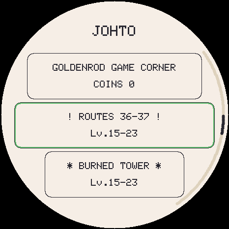 |

Levels are read from the games' scripts. The **first Explore in its home after
its badge always meets it** -- once. Win, lose, run or let it flee, the meeting
is spent as the fight starts; after that it comes back in **3 %** of that area's
encounters (a roamer, in 3 % across every open area of its region) until it is
**caught**, and then never again. Its home's row wears a star while it is still
out there. Difficulty does not change its level.

**Story legendaries are caught, not hatched.** A legendary with a home is never
in an egg. **Mythicals** (Mew, Celebi and the rest) have no home in any game's
story and stay egg-only, rare, under the same egg odds as ever: the legendary
egg tier opens at 25 species registered and is 3 % of eggs, 10 % after a
farewell, plus a care bonus. Since v3.49 every region's story legendaries have
homes; the legendaries of the games' expansions (Kubfu, Calyrex, the Loyal
Three, Ogerpon, Terapagos) and Pecharunt stay in eggs.

**Levels follow the gym ladder, not your pet.** An area's band ends just below
the level cap of the next gym battle it leads to:

| Areas opened by | Level band |
|---|---|
| nothing (the start) | 1 to (first leader's cap - 2): **1-12** in Kanto |
| g badges | (next battle's cap - 10) to (cap - 2): Mt. Moon **11-19**, Safari Zone **33-41**, Victory Road **44-52** |
| the champion | champion's cap +-5: **60-70** |

Caps are running maxima, so a band never goes down. An evolved form never
appears below where it could exist -- its floor is the lower of its evolution
level and the lowest level the game has it wild (a Metapod can be 4, as in
Viridian Forest). Where that floor is above the band, the creature stays where
the game put it and appears at its floor: Route 22's fishing Gyarados is level
15 though the band stops at 12 (and, being a best-rod catch, only after the
Rainbow Badge). The gym ladder's level cap handicaps a strong
early catch the same way it handles an over-raised pet.

**Hard changes how the wild creature fights, not how strong it is**: same band,
the smart battle AI, and two item drops instead of one. Every region has areas
since v3.49; the old region-wide pool below is only reached through ALL, which
Explore keeps switched off:

| Tier (the old region-wide pool) | Chance |
|---|---|
| ✨ Legendary | 1 % |
| 🔵 Rare | 7 % |
| ⚪ Evolved | 22 % |
| ⚪ Common | the rest |

- **Level** there: within 5 either side of yours, on either difficulty.
- **Shiny**: exactly **1/4096** per encounter, flooring every IV at 20 without
  capping one that already rolled higher.
- Ordinary IVs roll **8–31**, independently.

**Catching.** Pick a ball from the battle **BAG**. It spends your turn either way,
so throwing is never free.

`chance = base × hpFactor × statusFactor × ball / 10000`, capped at **95 %** — a
ball is always a gamble. The Master Ball is the one exception and never rolls.

| | |
|---|---|
| base | Common 30 · Evolved 24 · Rare 18 · Legendary 5 |
| hpFactor | 100 at full health rising to **180** just before fainting |
| statusFactor | **130** with any ailment, 100 without |
| ball | Poké **100** · Great **150** · Ultra **200** · Master *guaranteed* |

**Getting away.** Running from a wild fight is a roll, not a certainty: **90 %**
against something at or below your level, scaled down by the level ratio above it
with a **10 % floor**. Failing costs the turn.

**The wild creature can leave too**, and its curve is a tent rather than a slope —
it stops running once it is nearly beaten, which is what makes weakening it the
right way to catch it instead of a race:

| Its HP | Chance to flee |
|---|---|
| above 40 % | 0 % |
| 40 % | 10 % |
| 20 % | 20 % (the peak) |
| 10 % and below | 10 % |

It spends its **action** fleeing rather than fleeing *and* attacking, and a fight
it leaves pays nothing.

**Rewards.** A win grants **1** weighted item on normal and **2** on hard, plus one
independent **30 %** roll for a bonus. Each draw excludes every earlier one, so a
settlement can never list the same item twice.

| Item | Weight | What it does |
|---|---|---|
| Poké Ball | 30 | catch ×100 |
| Potion | 20 | +20 HP |
| Great Ball | 15 | catch ×150 |
| Super Potion / Full Heal | 10 each | +50 HP · clears an ailment |
| Protein / Iron / Carbos | 8 each | +5 STRENGTH / DEFENCE / SPEED |
| Ultra Ball | 6 | catch ×200 |
| Hyper Potion | 4 | +120 HP |
| **Master Ball** | **1** | catches without fail |

A new save starts with **5 Poké Balls and 3 Potions**. Stacks cap at 99.

The **BAG** menu row is the field bag, and it only offers the vitamins: the pet has
no persistent HP or ailment outside a fight, so a potion in the field would have
nothing to act on. Vitamins respect the same **IV-bound training ceiling**
(`trMaxFor`) as the punching bag and a gym reward — an item that could push past it
would make the IV roll decorative.

A caught creature takes a party slot, then a box slot, then asks — the same path a
farewell already uses. It is **not** added to the Pokédex on capture: registration
means "you raised this", so it happens when you actually make it the one you raise.

**Losing.** When a gym or wild fight is lost, the screen goes dark: you have
**blacked out**, and Mom is waiting at home to tell you your team is all better.
A tap or a swipe takes you back to your creature. Nothing is taken from you — no
money and no training; it is a moment, not a penalty. A LAN battle never blacks
out: a friendly match is just a result.

### Gym battles and badges

**Your TMs are the ones you own** (see Evolution and moves), so the early game
runs on level-up moves — SCRATCH, PECK, POISON STING, BUBBLE, ABSORB, SPARK,
FURY ATTACK and the rest — plus whatever TMs you have bought or found. A
leader's own TM moves open at level 40.

The first five gym leaders sit at levels **14–43**, so you fight the early
ladder on what your species actually learns. A creature retires at 73 and caps at 100. See "Nine gym ladders" above
for which regions have ladders and how they're verified.

**Gym wins train too**, which is what makes the ladder worth replaying rather than
a checklist you tick once:

| | Training a win is worth |
|---|---|
| Easy | **3–5** points, **+1 per 3 leaders** deeper into the ladder |
| Hard | **6–10** points, same ladder bonus |
| Which stat | **random**, but only among stats **not already at their ceiling** |
| Who gets it | the **live pet**, and only if it was in the squad |

A random stat that landed on a maxed one would silently evaporate, so it never
picks one; and the IV-bound ceiling above still applies, so a win can never push a
stat past what its IV allows. Banked members are frozen at what they were banked
with, and battling already costs the live pet energy — that, not a cooldown, is
what rate-limits rematching. A fully trained creature is told so.

### LAN battles

Pair two boards over ESP-NOW from the gym chooser's **LAN** button, then
**HOST BATTLE** on one board and **JOIN BATTLE** on the other. Bring whichever team you like: unlike the gym ladders there
is no level or team-size cap, since you already know what your opponent is
bringing. A running **head-to-head record** is kept against each rival —
keyed by their device, not their typed name, so renaming doesn't reset the
score — and shown on the pairing screen the next time you two fight.

### Trading

From the gym chooser's **LAN** button, tap **TRADE** on both boards.
They find each other on their own (no host or join).

- **What can be traded:** any creature in your **party or box**, never the
  one you are raising. One for one. Tap **YOU GIVE** to choose (the middle of
  the ring flips between your party and the three box pages); the other
  player's offer appears under **YOU GET**.
- **Both players tap ACCEPT** on the same two creatures. Changing either offer
  takes both acceptances back, so nobody can be switched out at the last
  second. Tap ACCEPT again to take yours back.
- **Refused before anyone accepts:** a creature from a region whose sprite pack
  is not on your card ("needs its region pack"), one with no sprite art at all,
  and one that is already on your board.
- **Trade evolution:** a creature that evolves by trade arrives *marked* and
  evolves the next time you raise it (§ Evolution and moves).
- **Keep both boards on and close** while it says TRADING. It takes a second or
  two.

**If the connection drops in the middle** — out of range, a reboot, a flat
battery — nothing is lost and nothing is duplicated, and you cannot leave the
trade screen until it is settled:

1. Both boards keep trying for **5 minutes**. The screen says
   *Connection lost... reattempting* with the time left, and what **this**
   board holds: *Trade appears incomplete (you have X)* or *Trade appears
   complete without confirmation (you have Y)*. Bring the boards back together,
   or switch the other one back on, and it finishes by itself. A board that
   rebooted mid-trade opens straight onto this screen.
2. After 5 minutes you are asked to decide, by **looking at the other board's
   screen**: if it says *complete*, choose **KEEP** (take theirs); if it says
   *incomplete*, choose **REVERT** (keep yours). It warns you first, because
   it **cannot be undone** — the board takes your word for it.

### The three endings, retiring, and your party

Every life ends one of three ways. You choose and witness each — none ever
auto-fires:

- 💛 **Farewell** — offered once it's a **final form** that has lived **3 days**.
  Triggering it **blesses your next egg**; you can postpone it ("stay together",
  re-offered a day later).
- 💔 **Run-away** — if you let **all four stats sit at 0 for a full hour**. A
  single act of care cancels it. It **curses the next egg** (forces Common).
  **Does not ask for confirmation, deliberately** — a creature you had to
  authorise to leave would not really be at stake.
- 👋 **Release** — long-press the creature on the main screen to let it go on
  your terms, no conditions.

**Farewell and release bank the creature** into your party (6 slots) instead
of ending the relationship — species, nickname, shiny status, IVs, training,
moves, level and its whole care state, frozen until you raise it again.
**A runaway does not join** — that's what makes it the one ending with a real
cost — and **neither does an early retire**:

**RETIRE** on the menu ends a creature whenever you like — what it costs
depends on whether the farewell had already been earned:

| | |
|---|---|
| Retiring one that has **earned** its farewell | free — it is simply the farewell reached by another button. It **joins your party** and **blesses** the next egg |
| Retiring one that has **not** | it is **gone for good** — not banked, not in the box — the next egg is **neutral** instead of blessed, and evolves **1 day later** than it otherwise would |

That evolution delay does not compound: retiring early more than once in a row
still costs only one extra day. The confirm dialog states the cost before you
accept it.

- **Choosing who you raise.** Tap a party slot and press **RAISE THIS ONE**. It
  is a true *exchange* — the creature on the main screen takes the slot the
  newcomer vacates — so it needs no free slot and nothing is ever lost. Both
  keep their full care state, so swapping away and back returns the creature
  exactly as it was. The one asymmetric case is an **egg**: it has nothing to
  bank, so its slot simply empties.
- **RELEASE also works on a banked creature** — tap a party or box slot to open
  its sheet, where RELEASE removes it permanently. It asks first, every time,
  and the creature does not fall into the box — the one way to free a slot
  without something taking its place. A box slot opens the same sheet rather
  than jumping straight into the party; **TO PARTY** does that instead.
- With a full party you're taken straight to the party screen to pick who the
  newcomer replaces, or to let it go. Nothing is ever overwritten silently.

After any ending, a **new egg** appears.

### The Poké Mart

On the tile axis between EXPLORE and the gyms, it turns real steps (the
board's onboard QMI8658 pedometer) into stock. **1 step = $1**, wallet capped at
**$999,999** — the real games' own money ceiling, not an invented number —
and a lifetime step count is tracked separately and never spent. Prices are
the real Poké Mart's (stable since Gen 1); Master Ball is never sold, same as
every game:

| Item | Price |
|---|---|
| Poké Ball | $200 |
| Great Ball | $600 |
| Ultra Ball | $1,200 |
| Potion | $300 |
| Super Potion | $700 |
| Hyper Potion | $1,200 |
| Full Heal | $600 |
| Protein / Iron / Carbos | $9,800 each |
| Linking Cord | $9,800 |

The **Linking Cord** is the one item that is *not* a real Poké Mart price: it
comes from *Legends: Arceus*, and its price was set to match the vitamins —
about a day's walking per evolution. See [trade evolution](#evolution-and-moves).

**TMs.** Below the items the Mart sells **five TMs a day**, a different five
each day (the same all day; with no clock set, always the same five). A TM you
own is never offered again, and one you buy leaves the day's list without
anything taking its place. A status TM costs **$2,000**; an attack **40 × its
power**, between **$1,500** and **$5,000**. A won wild battle also drops a TM
you do not own **5%** of the time on easy and **8%** on hard.

### Battle stats & IVs

Every pet rolls four **IVs** (individual values, 0–31) at hatch — ATK / DEF / SPD /
VIT — that never change and make each one genuinely unique:

```
stat = base + level + (IV × level)/100 + training
```

The `(IV × level)/100` term is the **real formula from Gen III onward** — a perfect
IV is worth +31 at level 100. But IVs do a second job here that they don't do in
the games: **they cap training.**

| | Effect |
|---|---|
| Innate bonus | up to **+22** at level 73 (end of a normal life) |
| Training ceiling | `70 + (30 × IV)/31` → **77** at IV 8, **100** at IV 31 |
| Total spread | ~**40 points**, about **15 %** between a great and a poor individual |

- **Rolls are 8–31, never 0.** In the real games a 0 IV is survivable because you can
  breed hundreds of eggs; here a pet lives 3 days, so a dud would just be a punishment.
- **Streak + bond bias the roll upward** (up to +7) — using the *previous* pet's care
  score. Raising one well genuinely improves the next.
- **Legendaries hatch with 3 of 4 IVs perfect**, exactly as they're guaranteed 3
  perfect IVs in the games.
- **Shinies floor every IV at 20** — a nod to Gen 2, where shininess *was* a DV
  pattern and a shiny was never mediocre.
- IVs are shown on the Battle page of the stat card; a perfect 31 is highlighted.

Training: **STRENGTH** ← the bag, **SPEED** ← the reaction test, **DEFENSE** ← the
ball game (and still 1 h of wellbeing passively), and two stats at half rate each
from Rock Smash (STR + SPD), Block! (DEF + SPD), Tilt Maze (SPD + DEF) and Boulder
Push (STR + DEF). A session pays at most 18 points however it is split. **VIT**
can't be trained. All of them live in the training menu (§ Actions).

**Special attack and defence** come off the species' own `bSpA`/`bSpD` base stats
(Alakazam is 50 Attack but 135 Special Attack), reusing the physical IV and
training rather than rolling their own — special attack runs off the ATK IV and
training, special defence off the DEF IV and training. So the physical/special
split lives on the species, not the individual — no extra IVs to roll.

### Bonds, streaks, medals, Pokédex

- **Streak** (player-wide, survives across pets): first care each real day; milestones
  at **3 / 7 / 30 / 100** days; skipping a day breaks it.
- **Bond** (per pet, resets on hatch): grows with affection (**cap +20/day**), cools on
  neglect. Both streak & bond improve egg/shiny odds — **and the IVs of your next pet**.
- **8 medals** (Lv10/25/50, favorite berry found, 7-day streak, max bond, final form,
  "fit" = fitness 80+ & no slip-ups), per-pet + a global counter.
- **Pokédex:** raising a species registers it. **809 can be obtained today**
  (Kanto to Alola) **+ shinies**; Galar and Paldea join when their sprite packs
  exist, which is why the counter reads out of 1025.
  Browsed **one region at a time** from a region chooser — drag along the rim to
  page within a region (swipe up jumps to the next one, down goes back), so
  nothing is more than ten pages from the front.
- **Name:** tap the header to open the touch keyboard; the nickname replaces the
  species name there and on the stat card.
- **Your avatar:** tap it on the trainer card to choose a look. There are **19**:
  RED, BLUE, and every Gen 1 trainer class with a sprite of its own (BEAUTY, BIKER,
  CHANNELER, ACE M/F, FISHER, GAMBLER, GENTLEMAN, GIRL, HIKER, ROCKER, ROCKET,
  SAILOR, SCIENTIST, SUPER NERD, SWIMMER, YOUNGSTER), three pages of nine.
- **Languages:** the UI ships in 6 — English (default), Spanish, French, German,
  Italian, Portuguese — switchable from Settings. Move names and battle
  narration follow whichever is chosen.
- **Region:** the pill under a waiting egg picks which generation it comes from —
  **Kanto / Johto / Hoenn / Sinnoh / Unova / Kalos / Alola / Galar / Paldea / All**. A first egg gives that
  region's starter. 41 species have no sprite art anywhere yet (13 in Unova,
  4 in Alola, 6 in Galar, 18 in Paldea); they keep their dex numbers but never hatch, since the egg would
  give a creature that could only ever draw as a number.
  A region whose **sprite pack is not on the card** shows as locked and is kept
  out of the egg pool, so a partial sprite install is a supported state. A pack
  sent from the web installer is picked up **as it lands** — the region unlocks
  without a reboot.

### Choosing your egg's region

The species is decided when the egg **appears**, not when it cracks, so changing
region moves the egg you are holding. Two rules stop that being a re-roll button:

| | Rule |
|---|---|
| Rarity | the tier the egg was granted is **kept** — only which species of that tier changes, so flipping can never fish for a legendary |
| Memory | each region's answer is **remembered** for the current egg, so switching back shows the same creature |

The region is first chosen at the **very start of a new game**, on the screen
before the starter (see "Starting out" in Screens above) — so the creature you
begin with and the eggs that follow come from the same place. Everything here
is about changing it afterwards.

A region is decided by the **base** species, and evolutions follow wherever they
lead — a Kanto run still reaches Crobat and Blissey.

## Hardware

- Board: [ESP32-S3-Touch-AMOLED-1.75](https://www.waveshare.com/wiki/ESP32-S3-Touch-AMOLED-1.75)
  — get the **Standard** (no case) or **-G** (GPS, also fits) version; **not the "-B"**
  (ships with a protective case that won't fit). The separate "1.75**C**" is a different board.
- Round 466×466 AMOLED, **CO5300** driver (QSPI, 80 MHz)
- Capacitive touch **CST9217** (I2C, address 0x5A)
- **AXP2101** (power management + battery + PWR button), **PCF85063** (RTC),
  microSD slot, **ES8311** audio codec (→ amplifier → external speaker on the
  MX1.25 connector)
- Pins taken from the [official Waveshare repo](https://github.com/waveshareteam/ESP32-S3-Touch-AMOLED-1.75) (see `pin_config.h`)

## Libraries (Arduino IDE / arduino-cli)

| Library | Author | Use |
|---|---|---|
| GFX Library for Arduino (`Arduino_GFX`) | moononournation | CO5300 over QSPI + framebuffer in PSRAM |
| SensorLib **0.4.1** (not 0.5.0, which boot-loops the board; see `sensorlib_guard.h`) | Lewis He | CST9217 touch + PCF85063 RTC + QMI8658 accelerometer |
| XPowersLib | Lewis He | AXP2101 PMU (battery, brightness, PWR button) |
| ESP_I2S (bundled in the ESP32 core) | Espressif | I2S to the ES8311 codec |

## IDE setup / build

- Board: **ESP32S3 Dev Module** · Flash **16MB** · PSRAM **OPI PSRAM**
  (required: the 466×466×16-bit framebuffer ≈ 434 KB lives in PSRAM) ·
  Partition Scheme with FAT (e.g. `16M Flash (3MB APP/9MB FATFS)`) ·
  USB CDC On Boot **Enabled**

```bash
FQBN="esp32:esp32:esp32s3:CDCOnBoot=cdc,FlashSize=16M,PSRAM=opi,PartitionScheme=app3M_fat9M_16MB"
arduino-cli compile --fqbn "$FQBN" .
arduino-cli upload -p /dev/cu.usbmodemXXXX --fqbn "$FQBN" .

# or just, which finds the port itself and can open the console:
bash tools/flash.sh --monitor
```

### Run it on your computer

`tools/emu/` compiles the **real firmware** — `TamaPoke.ino`, `pet.cpp`,
`i18n.cpp`, `party.cpp`, unmodified — into a clickable desktop app, stubbing only
the hardware. Click to touch, drag to swipe, type serial commands in the
terminal, and `--fast 60` runs a whole 3-day life in about an hour.

```bash
brew install sdl2          # Debian: apt install libsdl2-dev
bash tools/emu/build.sh
tools/emu/tamapoke-emu --scale 2 --fast 60
```

There's a headless `--shot` mode for screenshots too. See
[`tools/emu/README.md`](tools/emu/README.md). It won't tell you anything about
timing, DMA tearing, PSRAM or audio — those still need the board.

### Easiest install: the web installer

`web/index.html` flashes the firmware (ESP Web Tools) and pushes the sprites to
the SD over Web Serial, no Arduino needed. Serve it over HTTPS or `localhost`
(secure context) and open it in **Chrome/Edge**. See [`web/README.md`](web/README.md).

### Updating from an older version

Your creature, party, box, bag, badges and Pokédex carry over: the installer
never writes the part of the flash that holds the save. Still, **download a
backup first** (the installer's *Backup, then install* does it for you), and
**leave "Erase device" unchecked** — that box is the one thing that wipes a save.

- **A black screen right after installing is usually not a crash.** The board
  can be left in its download mode. Hold **PWR for about 10 seconds** to switch
  it fully off, then press it again.
- **Coming from v3.28 or earlier:** every creature is given its own ID on the
  first boot (needed for trading). **Going back below v3.31 afterwards empties
  the party and the box**, because older versions cannot read the longer
  records — keep the backup you took if you might downgrade.
- **Coming to v3.34:** hunger, energy, joy and hygiene now fall much more
  slowly while awake. An existing pet starts with a fresh 8-hour care window
  when it first boots on v3.34; after that only a **full** top-up (all four
  needs at 90+) restarts it. Petting wears off until you play a joy/bond game. A pet that was already asleep stays asleep until you wake it.
  The LAN BATTLE button is now just **LAN**, with HOST BATTLE, JOIN BATTLE and
  TRADE inside.
- **Building it yourself:** SensorLib must be **0.4.1**. 0.5.0 compiles and then
  boot-loops the board; the build now refuses it.

### Generate and load the sprites yourself

All sprites come from **[PMD SpriteCollab](https://github.com/PMDCollab/SpriteCollab)**
(CC BY-NC). You can regenerate the whole set and load it onto your board with the
pipeline below — the firmware accepts files over USB (PUT protocol with per-block
ACK), so you don't have to remove the card (it formats the SD to FAT if needed).

```bash
python3 tools/unpack_bundle.py  # FASTEST: restore tools/sdcard/mons/ from the committed web/sprites-*.pak (no network)
python3 tools/pack_pmd.py       # or fetch from source: PMD sprites, normal + shiny, every region in dex_data.REGIONS
python3 tools/make_thumbs.py    # Pokédex thumbnails (from the PMD sprites) -> thumbs.bin
python3 tools/send_sd.py        # send tools/sdcard/mons/* to the board's SD over USB
```

`unpack_bundle.py` is the one you want unless you are adding a region: the `.pak`
bundles are committed, so it needs no network and gives you the exact bytes that
ship. `pack_pmd.py` re-fetches ~40 MB per region from SpriteCollab.

To make the **one-click web-installer bundle** instead of sending over USB:

```bash
python3 tools/pack_bundle.py    # bundle tools/sdcard/mons/* into web/sprites.pak
```

Then load it from the web installer's **"Load sprites"** button (or `send_sd.py`
above). `pack_pmd.py` also takes individual dex numbers, e.g. `pack_pmd.py 7 25`.
(~40 MB total, all PMD. Versioned under `tools/sdcard/`.)

## Sprites: PMD SpriteCollab everywhere

- **PMD SpriteCollab** (everything — main screen, stat card, minigame **and the
  Pokédex grid + detail view**): behaviour sprites — `tools/pack_pmd.py` packs
  actions (Idle, Walk L/R, Sleep, Eat, Hurt, Attack, Pose, Nod, DeepBreath) into
  the multi-action **TPK2** format (`/mons/pNNN.bin`). The engine in `TamaPoke.ino`
  makes the creature wander, gesture, curl up to sleep, chew and wince. Anchored by
  the feet (lowest content row), not the canvas. The Pokédex thumbnails
  (`thumbs.bin`, TPTH) are derived from these by `tools/make_thumbs.py`.
- **In-house workshop** (`tools/sprites.py`): 9 primitive-drawn sprites as a
  no-SD fallback + the UI icons. Generates `species.h`. Preview in
  `tools/sheet.png`, emit with `python3 tools/sprites.py emit`.

`sdmon.h/.cpp` loads the PMD sprites into PSRAM (`PmdMon` for TPK2) plus the
thumbnails (`SdThumbs`). `SdMon` (TPK1) remains as a dormant legacy fallback only.

## Pokédex and species data

`tools/dex_data.py` is the **single source**: name, slug, type (accent colour +
background biome), evolution line with gen-1 levels, rarities and starters.
`tools/dex_stats.py` has the base stats and `tools/dex_types.py` the typings and
type chart (both from PokéAPI). Note these are **current** values, not Gen 1 ones —
Pidgeot has 101 Speed here, not the 91 it had in Red/Blue. `gen_dex.py` emits
`dex.h` (the `DEX_TBL[152]` table). The pet's identity is its Pokédex number
(persisted in NVS). See [Evolution](#evolution) in Game manual for the rules.

## Types

Every species carries its real **typing** (one or two of the 18 types) and the game
ships the full **18×18 effectiveness chart** — `dex.h` holds both, generated from
`tools/dex_types.py`.

The chart is the **current (Gen 6+) one, not Gen 1's**, which is a deliberate call:

- Gen 1's chart shipped real bugs — Ghost moves did literally nothing to Psychic —
  and Psychic was resisted only by Psychic, so it ran away with every fight.
- The base stats here were **already** pulled from PokéAPI at current values, so
  modern stats with an ancient chart was the inconsistent pairing.
- **Fairy earns its keep:** Dragonite has the highest Attack in the dex, and before
  Gen 6 Dragon was resisted only by Steel. Dragon → Fairy is **0×**, so Clefable
  hard-walls the strongest thing you can hatch.

Seven of the original 151 differ from their Gen 1 typing: Magnemite and Magneton gained Steel
(Gen 2), and Clefairy, Clefable, Jigglypuff, Wigglytuff and Mr. Mime gained Fairy
(Gen 6) — the first two losing Normal entirely.

Typing is shown on the Battle page of the stat card.

## Backgrounds: biome + real time

The idle screen paints the sky from the **RTC's real time** (dawn / day / dusk /
night with moon and stars) and the ground from the **type's biome** (meadow,
beach, forest, volcano, mountain, snow). Sleeping forces night.

## Layout

- `TamaPoke.ino` — init, game loop, render of every screen, gestures, serial console, audio
- `pet.h` / `pet.cpp` — pet state and logic (stats, evolution, life cycle, streak/bond/medals, NVS)
- `party.h` / `party.cpp` — the 6 retired pets kept from farewells and releases
- `sdmon.h` / `sdmon.cpp` — TPK1 (animated) and TPK2 (PMD) sprites + thumbnails, and file reception over USB (PUT/LS)
- `rtcbat.h` / `rtcbat.cpp` — PCF85063 RTC + AXP2101 PMU (battery, brightness, PWR button)
- `audio.h` / `audio.cpp` — ES8311 + I2S + Game-Boy-style tone synth (non-blocking task)
- `battle.h` / `battle.cpp` — the battle engine: damage, crits, stages, ailments, turn order, the AI
- `link.h` / `link.cpp` — the LAN battle protocol, radio-free so it can be tested
- `linknow.h` / `linknow.cpp` — its ESP-NOW transport, shared with trading
- `trade.h` / `trade.cpp` — the trading protocol (the design is the header comment)
- `save.h` / `save.cpp` — `EXPORT` / `IMPORT`, the key-driven save backup
- `wild.h` / `wild.cpp`, `inventory.h` / `inventory.cpp`, `items.h` — wild encounters, capture, the bag, Mart prices
- `pedometer.h` / `pedometer.cpp` — software step detector (and the tilt reading Tilt Maze uses)
- `sensorlib_guard.h` — refuses to build against SensorLib 0.5.0, which boot-loops the board
- `i18n.h` / `i18n.cpp` — the 6-language string tables
- `move_names.h` — GENERATED (`gen_moves.py`): move display names in all 6 languages
- `dex.h` — GENERATED (`gen_dex.py`): the species table, `DEX_COUNT` 1025
- `species.h` — GENERATED (`sprites.py`): fallback sprites, UI icons, colours
- `pin_config.h` — the board's official pins
- `tools/` — pipeline: `dex_data.py` (data), `dex_stats.py`, `dex_types.py`, `gen_dex.py`,
  `dex_move_names.py` / `gen_moves.py` (localized moves),
  `sprites.py` (workshop), `pack_pmd.py` / `make_thumbs.py`
  (packers), `pack_bundle.py` (web bundle), `send_sd.py` (SD upload), `touch_log.py`
- `tools/emu/` — desktop emulator (real firmware + stubbed hardware, SDL)
- `tools/sdcard/mons/` — the generated .bin files (animated, shiny, PMD, thumbnails)
- `web/` — the browser installer (ESP Web Tools + Web Serial sprite loader)

## Serial console (115200, debug)

`STATS` (full state) · `SPEC <dex>` (change species) · `LVL <n>` ·
`IV <atk> <def> <spd> <vit>` (force individual values) · `HATCH` ·
`EGG <dex> [shiny]` (hatch a chosen species — the only way to test the
legendary/shiny IV guarantees, which apply at hatch) ·
`SHINY` · `NICK <x>` · `BYE` / `RUN` (farewell / runaway) · `ABANDON` (force the
runaway-ready state) · `WIPE` (factory reset → new game) · `BEEP` (audio test) ·
`REG` (Pokédex) · `EGGS` (simulate 20 eggs) · `GAL` (gallery) · `CAREDAY` ·
`PARTY` / `PARTY <dex>` / `PARTY CLEAR` (inspect and fill the party) ·
`FOCUS <slot>` (swap the creature you are raising with a party slot) ·
`BAG` (list it) · `GIVE <key> [n]` (stock it) · `WILD` / `WILD HARD` (force an
encounter, naming the area and flagging a legendary) · `AREA` / `AREA <n>` (list the Explore region's
areas with their gates, bands and today's weather / pick one) ·
`TIME <epoch>` / `RTCSET <epoch>` · `HEALTH` (uptime + heap for the soak test) ·
`LS` / `PUT` (SD files).

To test fast: lower `PET_TICK_MS`, `MINUTES_PER_LEVEL` and `FAREWELL_AGE_MIN` in `pet.h`.

## Credits

This is a fork of [**DylanPDao/TamaPoke**](https://github.com/DylanPDao/TamaPoke)
by **Dylan Dao**, which is itself a fork of the original
[**socquique/TamaPoke**](https://github.com/socquique/TamaPoke) by
**Quique Tortosa** — the firmware, sprite pipeline, six-language UI and web
installer all started there.

All sprites: [PMD SpriteCollab](https://github.com/PMDCollab/SpriteCollab)
(community, CC BY-NC). Base stats: [PokéAPI](https://pokeapi.co). Pokémon is a ™ of
Nintendo / Game Freak / The Pokémon Company. Non-commercial, personal-use project.
Full list in [`CREDITS.md`](CREDITS.md).

## License

- **Source code** (firmware + tooling): **[MIT](LICENSE)**.
- **Sprites & names**: © Nintendo / Game Freak / The Pokémon Company; pixel art
  from [PMD SpriteCollab](https://github.com/PMDCollab/SpriteCollab) (CC BY-NC 4.0).
  **Non-commercial use only.**
- **3D-printed case**: remix of *"Pokeball"* by **yoyothechicken**
  ([MakerWorld #839922](https://makerworld.com/es/models/839922-pokeball)),
  licensed **CC BY-NC-SA**, and shared here under the same terms.

This is an unofficial fan project, not affiliated with or endorsed by Nintendo.
