# TamaPoke Player's Guide

**For firmware v4.12.** How to raise, train and battle with your TamaPoke, and
where everything is.

The guide has two parts. **Part 1, the Player's Manual**, explains how each part
of the game works, in the order you meet it. **Part 2, the Walkthrough and
Strategy Guide**, says where every Pokemon lives, how to beat every leader, and
how to win the side games. Read Part 1 once, and keep Part 2 open while you play.

<!-- BEGIN GENERATED: counts -->
The game holds 1025 Pokemon (984 of them drawn so far), 366 Explore areas in 9 regions, 117 gym leaders, Elite Four members and champions, 58 legendaries with a home, 8 one-off encounters, 30 swarms and 134 TMs plus 10 signature TMs.
<!-- END GENERATED: counts -->
Every list in Part 2 and every price in the appendices is generated from the
game's own data, so they match the firmware this guide was made with.

> **A note on spoilers.** Part 2 shows what lives where and how to beat each
> leader. If you would rather find things out by playing, stay in Part 1.

## Contents

**Part 1: Player's Manual**

1. [Getting started](#1-getting-started)
2. [Finding your way around](#2-finding-your-way-around)
3. [Caring for your Pokemon](#3-caring-for-your-pokemon)
4. [Growing up](#4-growing-up)
5. [Training](#5-training)
6. [Endings and new eggs](#6-endings-and-new-eggs)
7. [Battle basics](#7-battle-basics)
8. [Exploring and catching](#8-exploring-and-catching)
9. [Gyms and the Pokemon League](#9-gyms-and-the-pokemon-league)
10. [Your collection](#10-your-collection)
11. [Money and the Poke Mart](#11-money-and-the-poke-mart)
12. [Playing with friends](#12-playing-with-friends)
13. [The Battle Hall](#13-the-battle-hall)
14. [The Battle Zone](#14-the-battle-zone)
15. [Settings and keeping your save safe](#15-settings-and-keeping-your-save-safe)

**Part 2: Walkthrough and Strategy Guide**

- [The walkthrough, region by region](#the-walkthrough-region-by-region)
- [Your first week](#your-first-week)
- [How to get every Pokemon](#how-to-get-every-pokemon)
- [Raising a strong Pokemon](#raising-a-strong-pokemon)
- [Spending money well](#spending-money-well)
- [Where to find every TM](#where-to-find-every-tm)
- [The Safari Zones](#the-safari-zones)
- [The side games](#the-side-games)
- [The post-game](#the-post-game)

**Appendices**

- [A. Type chart](#appendix-a-type-chart)
- [B. Quick reference](#appendix-b-quick-reference)
- [C. Glossary and common questions](#appendix-c-glossary-and-common-questions)

---

# Part 1: Player's Manual

## 1. Getting started

### What you need

- The **Waveshare ESP32-S3-Touch-AMOLED-1.75** board (the round one).
- A **microSD card** in the board, for the Pokemon sprites. Any size works.
- A computer with **Chrome or Edge**, for the web installer.

### Installing

Open the [web installer](https://codester00.github.io/TamaPokeLAN/web/), plug
the board in with a USB cable, and follow the page. It installs the game and
copies the **sprite packs** to the card, one pack per region. You can install
only Kanto to start and add the others later; a region whose pack is missing
shows **NEEDS PACK** and stays locked until you add it.

If you are updating a board that already has a game on it, use **Backup, then
install**. It saves your game to a file before it installs anything. Never tick
**Erase device**: that is the one thing that wipes a save.

> **PRO TIP:** A black screen right after installing usually means the board is
> waiting in its download mode, not that something broke. Hold the **PWR**
> button for about 10 seconds to switch it fully off, then press it again.

### Your first minutes

| Pick a region | Pick a starter | The egg |
|---|---|---|
|  |  | 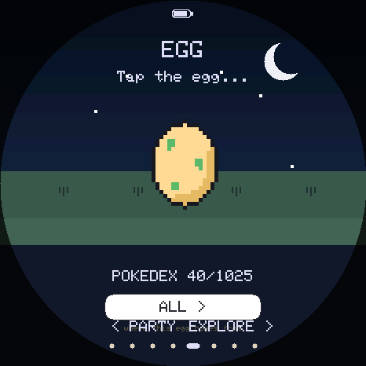 |

1. **Pick a region.** The first screen asks which region you want to play. It
   decides your starter and where your eggs come from. You can change the egg
   region later.
2. **Pick a starter** from that region's three.
3. **Hatch the egg.** Tap it three times, or wait three minutes and it hatches
   by itself.
4. **Set the clock.** Tap your Pokemon's name at the top, then **SETTINGS**,
   then **SET TIME**, and set the hour, the minute and the **day of the week**.
   Day and night, naps, Friday's Lapras and the daily rotations all follow it.

You start with **5 Poke Balls and 3 Potions**.

## 2. Finding your way around

The screen is round, so there are no corner buttons. Every screen uses the same
four gestures:

| Gesture | What it does |
|---|---|
| **Swipe left or right** | Move to the next screen along the row below |
| **Swipe up** | Go deeper: from your Pokemon, its card |
| **Swipe down** | Go **back** one level, from anywhere |
| **Drag along the edge** | Turn the page of a list (the bar on the edge shows where you are) |

The screens sit in a row, with your Pokemon in the middle:

**PLAYER · POKEDEX · MART · PARTY · [your Pokemon] · EXPLORE · GYM · PLAZA**

Your own things are on the left and battles are on the right. The row stops at
both ends; swiping never closes anything.

| Your Pokemon |
|---|
| 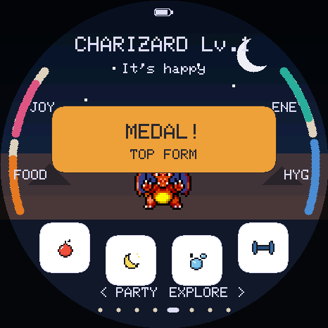 |

- **Tap your Pokemon's name** at the top for the menu: STATS, BAG, POKEDEX,
  SETTINGS, RETIRE and CLOSE.
- **Tap your Pokemon** to pet it.
- **The PWR button:** a short press turns the screen off or on. Holding it for
  4 seconds switches the board off. Time still passes while it is off.
- Most screens also have a **BACK** button at the bottom.

## 3. Caring for your Pokemon

Your Pokemon has four needs, each from 0 to 100: **FOOD**, **JOY**, **ENERGY**
and **HYGIENE**. They show as arcs around the edge of the main screen. The four
buttons along the bottom look after them.

| Button | What it does |
|---|---|
| **Food** | A **berry** (three flavors) gives +25 food. A **candy** gives +10 food and +12 joy, but costs a lot of fitness. |
| **Light** | Puts it to bed, or wakes it up. |
| **Bath** | Cleans up any mess and sets hygiene to 100. |
| **Training** | Opens the training games (chapter 5). |

**Favorite berry.** Every species secretly loves one of the three berry
flavors. That flavor gives +35 food and +10 joy, raises its bond and costs
almost no fitness. Once found, it is shown on the card.

**Petting** gives +10 joy, then +8, +6, +4, +2, then nothing. Playing one of the
joy games (Berry Catch, Memory, Hide and Seek) makes petting fresh again.

**Mess.** A well-fed Pokemon makes a mess about every hour and a half. Each
mess on screen makes hygiene fall faster, so bathe it.

### How fast needs fall

While awake, food, energy and joy each fall about **10 an hour**, and hygiene
about 7. Joy falls faster when the Pokemon is hungry or dirty, and energy
falls twice as fast when it is out of shape.

### The 8-hour rule

Get **all four needs to 90 or more**, and you can walk away for **8 hours**.
It will be hungry, tired and wanting attention when you come back, but it will
not be harmed and cannot run away.

- Only topping up **all four** above 90 starts a fresh 8 hours. One snack does
  not.
- After the 8 hours, neglect counts. A need at 10 or below is a **care
  mistake** (at most one an hour). Each mistake delays every evolution by one
  level and cools your bond.
- With all four needs at **zero for an hour**, it is ready to **run away**.
  From fully cared for, that takes about 13 hours.

### Sleep, naps and the morning

| When you press Light | What happens |
|---|---|
| **18:00 to 06:00** (bedtime) | It sleeps through the night and **sleeps in until 08:00**. |
| **06:00 to 18:00** (a nap) | It gets up by itself once its **energy is full**, about 15 minutes from tired. |

- From **08:00 to 18:00**, anything still asleep gets up once its energy is
  full.
- Turning the **screen off between midnight and 06:00** puts it to bed too.
- You can always wake it yourself with the Light button.
- Asleep, it rests (+6 energy a minute), its other needs fall slowly and never
  very low, and it cannot run away or make care mistakes.
- **A full night's sleep or a nap that fills its energy refills PP** for your
  whole team (chapter 7).

> **PRO TIP:** Before school or work, feed it, bathe it and play a joy game
> until all four needs read 90 or more, then put it down for a nap. It wakes
> rested, and you have 8 hours.

### Fitness and weight

The card shows **FITNESS** (0 to 99, starting at 75) and a **weight** in kg.
The weight is the species' real Pokedex weight at fitness 75, lighter above
and heavier below. Fitness rises slowly by itself and with the training games.
Candy and plain berries lower it. Below 50, energy drains twice as fast.

## 4. Growing up

### Levels

**Level is age: +1 level every hour**, up to **level 100** (4 days and 3 hours).
Care does not make it grow faster, but care mistakes delay evolution. It keeps
growing while the board is off, catching up as much as two weeks.

**The card** (swipe up from your Pokemon, or STATS on the menu) has four pages:
the profile (name, level, fitness, weight, gender, what it evolves into), its
battle stats and IVs, its moves, and its progress (its level, the time to the
next one and its next evolution). Drag along
the edge to turn the pages. Tap the name on the profile to rename it.

### Moves

A Pokemon knows up to **four moves**.

- **Level-up moves** come at the levels the games teach them. An empty slot
  fills by itself; with four already, the game asks which move to forget, or
  you can skip it.
- **The MOVES page** of the card lets you swap in **any move it could know** at
  its level, at any time, and as often as you like.
- **TMs** (chapter 11) teach moves a species learns only by TM. Once you own a
  TM it teaches every Pokemon that can learn it, at any level, as often as you
  like.

### Evolution

When an evolution is ready, a button appears. **Tap it to watch it happen**,
or tap **keep form** to wait; it asks again at the next level. An evolution
needs every need at **40 or more** at that moment.

| How it evolves | What to do |
|---|---|
| **By level** | Reach the level. Each care mistake adds a level. |
| **By stone** | Use the stone from the **BAG** on the Pokemon you are raising, at any level. Stones cost $2,100 at the Mart and turn up after wins in some areas. There is no level route. |
| **By trade** | Trade it to another board, or use a **Linking Cord** ($9,800) on it. It evolves the next time it is the one you raise. |
| **By choice** | Applin and Charcadet let you pick which form, at level 30. |
| **Other** | Tyrogue by its Attack and Defense, Wurmple and Cosmoem by the creature, Meltan by walking 10,000 steps, and a few by gender. |

**Eevee** evolves with the Water, Thunder, Fire, Leaf or Ice Stone. With **bond
40 and at least two days old**, it becomes **Espeon** by day, **Umbreon** by
night, or **Sylveon** if it knows a Fairy move.

**Evolving teaches moves.** The new form learns the level-up moves it has
already passed, so a late evolution does not leave empty slots.

### Gender

Most species are male or female, half and half, fixed when the Pokemon hatches
or is caught. The card shows it beside the name. Some species are always one
gender or have none. Gender decides a few evolutions: Burmy, Combee, Salandit,
and the Dawn Stone for Kirlia and Snorunt.

## 5. Training

Training makes a Pokemon stronger in battle. Each stat (**Attack**, **Defense**,
**Speed**) has a training value from 0 to 100. Special Attack runs off Attack
training and Special Defense off Defense training.

### The training games

| The list | Rock Smash | Block! | Memory |
|---|---|---|---|
| 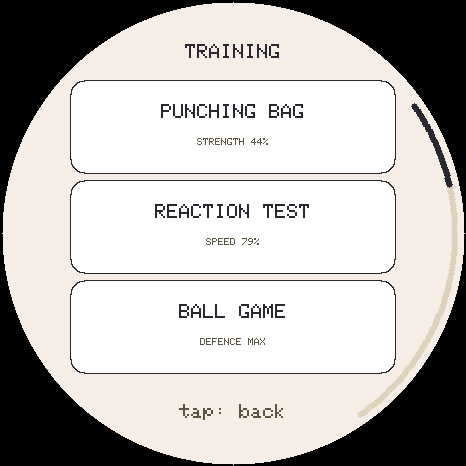 | 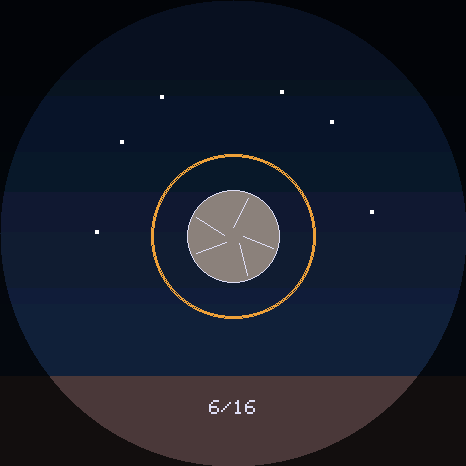 | 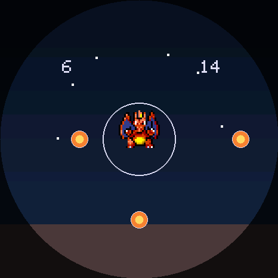 | 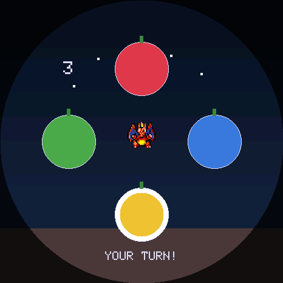 |

Tap the **dumbbell** to see the list. Each row says what the game raises and how
far along that stat already is.

| Game | Raises | How to play |
|---|---|---|
| **Punching Bag** | Attack | Tap to punch. About 4 hits make a point. |
| **Reaction Test** | Speed | Tap each target before it shrinks away. |
| **Ball Game** | Defense (and a little joy) | Keep the ball in the air. |
| **Rock Smash** | Attack + Speed | Tap as the ring lands on the rock. Perfect timing scores double. |
| **Block!** | Defense + Speed | Tap the side an attack comes from. Tapping an empty side wobbles your shield. |
| **Tilt Maze** | Speed + Defense | Tilt the board to roll the ball into the green goal. Needs the motion sensor. |
| **Boulder Push** | Attack + Defense | Tap while the needle is in the green. Tapping outside the middle slips the boulder back. |
| **Berry Catch** | Joy + bond | Drag the basket to catch berries; dodge the rocks. |
| **Memory** | Joy + bond | Repeat the berries' sequence. |
| **Hide and Seek** | Joy + bond | Follow the bush your Pokemon hid in. |

- A session pays at most **18 training points**. A game that trains two stats
  splits them (9 + 9).
- **It costs what it pays:** a full session costs **12 energy and 5 food**, a
  smaller one less, and a round that earned nothing costs nothing.
- Below **15 energy** a Pokemon is **TOO TIRED** to train. The joy games still
  open.
- Leaving a game early keeps what you earned. The result screen says what you
  got, and a zero says why (**MAX**, **JOY MAX**, or **BOND MAX TODAY**: bond
  can rise at most 20 a day).

### How far a Pokemon can train

Every Pokemon has four **IVs** (0 to 31, rolled when it hatches and never
changing; here between 8 and 31). They add a little to each stat, and they also
set its **training ceiling**: **70 + 30 × IV / 31**. An IV of 31 can train to
100; an IV of 8 stops at 77. The card's battle page shows its IVs, with a
perfect 31 highlighted.

**Training counts more as a Pokemon grows.** In battle, training adds
training × level / 100 to a stat: full training is +100 at level 100 and +14 at
level 14. The training screen shows the 0 to 100 value; the card shows the
real battle numbers.

### Other ways to train

- **Vitamins** (Protein, Iron, Carbos) give +10 training each. With a party,
  the bag asks who gets it.
- **Gym wins** train the Pokemon you are raising, if it fought: 3 to 5 points
  on easy, 6 to 10 on hard, a little more deeper into the ladder, always in a
  stat that still has room.
- **Defense** also rises by 1 for each hour your Pokemon spends happy and well.

## 6. Endings and new eggs

Every Pokemon's time with you ends one of three ways. You choose and watch
each one.

| Ending | When | What happens |
|---|---|---|
| **Farewell** | Offered once it is in its **final form** and has lived **3 days** (level 73) | It joins your **party**, and your next egg is **blessed**. You can say "stay together" and it asks again a day later. |
| **Release** | Any time: hold your Pokemon on the main screen for 3 seconds | It joins your party, and the next egg is ordinary. |
| **Run away** | All four needs at zero for an hour | It is gone for good, and the next egg can only be **common**. |

**RETIRE** on the menu ends a Pokemon whenever you like. Retiring one that has
earned its farewell is the same as the farewell. Retiring one that has not
loses it for good, and its next egg evolves a day later.

A Pokemon waiting for an evolution by trade counts as final for its farewell,
unless it is already marked to evolve.

### The next egg

After any ending a new egg appears. **The pill under the egg** picks its region
(any region whose pack you have, or ALL). The rarity the egg rolled stays when
you switch, and each region remembers its answer, so switching cannot fish for
a rare one.

| Egg | Ordinary | After a farewell |
|---|---|---|
| Legendary | about 3% | about 10% |
| Rare | about 27% | about 45% |
| Common | the rest | the rest |

- Legendary eggs start only once you have **registered 25 species**.
- A long **daily streak** and a strong **bond** raise these odds.
- An egg prefers species whose evolution line you have not finished, so every
  Pokemon can be collected.
- **Shiny:** a farewell egg is shiny about 1 time in 100, other eggs 1 in 200.
  The best streak and bond make that up to 4 times likelier.
- **Story legendaries do not hatch.** They live in Explore. Mythicals (Mew,
  Celebi and the others) still come from eggs.

## 7. Battle basics

### The battle screen

| The menu | Picking a move | Blacked out |
|---|---|---|
| 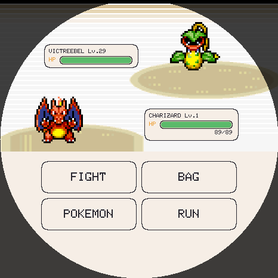 | 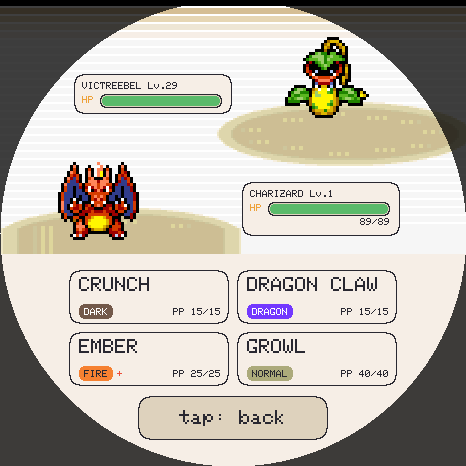 | 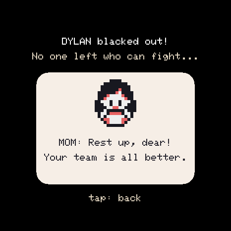 |

Your Pokemon is at the bottom left, the opponent at the top right, each with an
HP bar. The menu has four choices:

| | |
|---|---|
| **FIGHT** | Pick one of your four moves. Each shows its type and the PP left. |
| **BAG** | Use an item: a ball, a potion, a Full Heal or an X item. It takes your turn. |
| **POKEMON** | Switch to another team member. It takes your turn. |
| **RUN** | Escape a wild Pokemon. Anywhere else, running counts as a **loss**, and it asks first. |

### Damage

- **Types matter.** A super effective hit does double damage, a resisted one
  half, and some types cannot hurt others at all. See the
  [type chart](#appendix-a-type-chart).
- **Same type bonus:** a move that matches one of its user's types does 1.5x
  damage.
- **Critical hits** land about 1 time in 16, for 1.5x damage, and ignore the
  stat changes that would weaken the hit.
- **Stat changes** go from -6 to +6 and reset when a Pokemon switches out. Many
  attacks change a stat as well as doing damage.

### Status problems

| Problem | Effect |
|---|---|
| **Paralysis** | Speed halved; loses a turn 1 time in 4. Electric types are immune. |
| **Burn** | Attack halved; loses 1/16 of its HP each turn. Fire types are immune. |
| **Poison** | Loses 1/16 of its HP each turn. Poison and Steel types are immune. |
| **Sleep** | Cannot move for 2 to 4 turns. |
| **Freeze** | Cannot move; thaws 1 time in 5 each turn. Ice types are immune. |
| **Confusion** | Hurts itself instead of moving about 1 time in 3, for a few turns. |

A **Full Heal** cures them. They all end with the battle.

### PP

Every move has its real PP: TACKLE 35, SURF 15, RECOVER 5. Each use costs 1.
**Your PP carries from fight to fight**, and comes back for your whole team
when the Pokemon you are raising fills its energy while asleep. With no PP
left in any move, it uses **STRUGGLE**, which hurts the user too. Opponents
always start full.

### Two-turn moves

DIG, FLY, BOUNCE, DIVE and SHADOW FORCE take the user out of reach for a turn,
then strike. While it is away, attacks aimed at it miss, except the moves that
can reach it:

| Hidden by | Still hit by |
|---|---|
| DIG | EARTHQUAKE, for double damage |
| FLY, BOUNCE | GUST for double; THUNDER, HURRICANE and SKY UPPERCUT |
| DIVE | SURF, for double damage |
| SHADOW FORCE | nothing |

### Faints and switching

- **You choose who comes on** after one of yours faints. It costs no turn.
- **Against a trainer**, when their Pokemon faints you are told what they send
  next and may switch first, for free. Tap NO to keep yours out.
- **On hard**, trainers send the Pokemon that suits the fight best.

### Losing

If your whole team faints, you **black out**: Mom is waiting at home and your
team is all better. Nothing is taken from you. A LAN battle never blacks out.

### Special moves

- **SKETCH** (Smeargle) copies the last move the opponent used, **for good**.
  A failed Sketch keeps its PP.
- **TRANSFORM** (Ditto) turns Ditto into the opponent for the fight: its look,
  type, stats and moves. It is a Ditto again afterwards.

## 8. Exploring and catching

### Explore

| Explore | An area list | A wild Pokemon |
|---|---|---|
| 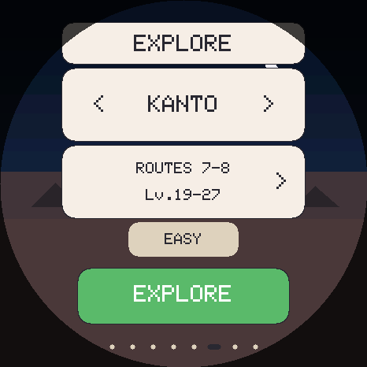 | 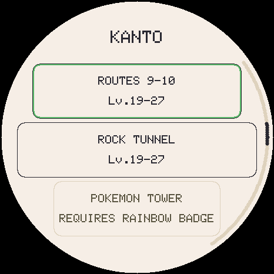 | 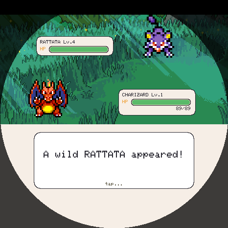 |

Swipe right from your Pokemon to **EXPLORE**. Pick a **region** with the arrows
at the top, then tap the **area row** to choose where to go. Then pick **easy**
or **hard** and tap the big button to meet a Pokemon.

- **Areas open with badges**, as in the games. A locked area says what it
  needs, for example **REQUIRES BOULDER BADGE**. A badge won on easy or hard
  both count.
- **Levels follow the gym ladder**, not your Pokemon: an area's Pokemon are a
  little below the next leader you will face. A few evolved Pokemon appear above
  the area's levels, where the games put them.
- **Easy or hard** does not change levels. On hard, wild Pokemon fight smarter
  and you get better drops.
- **Time and weather.** In Johto, Sinnoh and Paldea some Pokemon come out only
  in the morning, by day or at night. In Galar and Paldea each wild zone has one
  **weather a day**, shown on its row (for example `Lv.26-34 FOG`), and some
  Pokemon come only in their weather.
- **Swarms.** Some days an area has a **swarm** of one Pokemon, shown as
  **SWARM** on its row.
- **NEEDS PACK** means that region's sprite pack is missing. **NO VALID
  SPRITES** means nothing in that area can be drawn yet.
- A small **ball** on a wild Pokemon's name plate means you already own one.

### Legendaries and one-off encounters

- **Legendaries live where they did in the games.** The **first visit** to its
  home, once you have the right badge, **always meets it**. After that it comes
  back now and then until you catch it. A few **roam** their whole region after
  the first meeting.
- **One-offs** stand where the games put them: the sleeping Snorlax, Sudowoodo,
  Lapras on Fridays, the red Gyarados and a few more. They work the same way.
- A row shows **`* AREA *`** when a legendary's certain meeting is waiting, and
  **`! AREA !`** for a one-off.

### Catching

Weaken it first, then throw a ball from the **BAG**. Throwing takes your turn.

- A ball works better the lower its HP and if it has a status problem. A Great
  Ball is 1.5 times a Poke Ball, an Ultra Ball twice, and a **Master Ball**
  never fails.
- A wild Pokemon may **run away** when it is low on HP, most often at about a
  fifth of its HP. It stops running when it is nearly beaten, which is the best
  moment to throw.
- **RUN** from a wild Pokemon usually works, less often against one well above
  your level.
- A caught Pokemon goes to your **party**, then to **Bill's PC**.

### Drops

A won wild battle gives **one item**, and a second 25% of the time on easy or
50% on hard. On top of that, a win may bring a **TM** you do not own (5% easy,
8% hard), and in some areas an **evolution stone** (about one win in 25). The
items and their chances are in [Appendix B](#appendix-b-quick-reference).

### Safari Zones

Kanto's **Safari Zone**, Hoenn's **Safari Zone** and **Safari Extension**, and
Sinnoh's **Great Marsh** work like the games: **no team of yours fights**, and
each encounter brings **30 Safari Balls** of its own. Instead of FIGHT, you get
that game's tools:

| Where | Choices |
|---|---|
| Kanto | BALL, BAIT (it eats and stays, but is harder to catch), ROCK (easier to catch, but angry and likelier to flee), RUN |
| Hoenn | BALL, POKEBLOCK (less likely to flee), GO NEAR (easier to catch, but likelier to flee), RUN |
| Sinnoh | BALL, BAIT, MUD, RUN |

See [The Safari Zones](#the-safari-zones) for the best pattern for each Pokemon.

### The Game Corners

Two areas are not wild areas: **CELADON GAME CORNER** (Kanto, after Lt. Surge)
and **GOLDENROD GAME CORNER** (Johto, after Bugsy). Buy coins with your money,
play slots or card flip, and trade coins for Pokemon and TMs. See
[The side games](#the-side-games).

## 9. Gyms and the Pokemon League

Swipe to **GYM**, pick a region, and tap a leader.

| Pick a region | A ladder | Your team | A win |
|---|---|---|---|
| 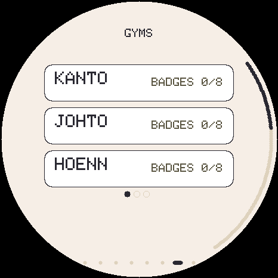 | 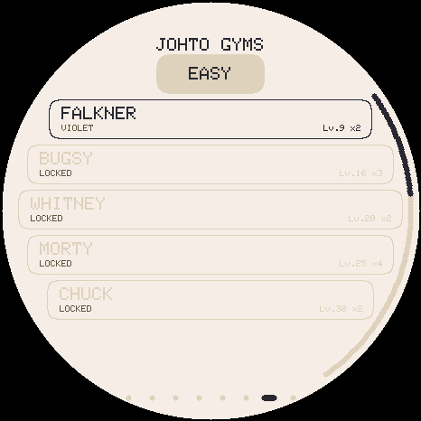 | 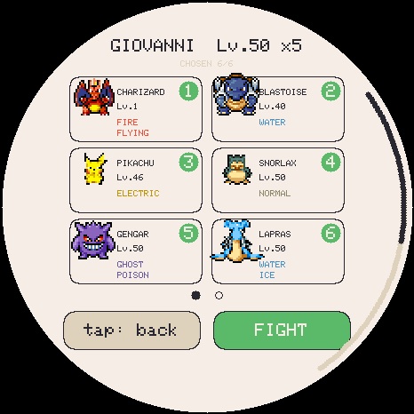 | 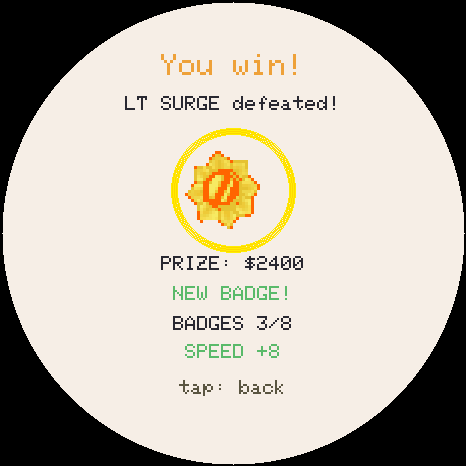 |

- **Nine regions**, each with **8 gym leaders** (Alola has trial captains and
  kahunas), **4 Elite Four members** and a **champion**. Leaders open in order.
- **Easy or hard.** On easy, leaders have average IVs and no training. On hard,
  they have perfect IVs, training and smarter battle choices, and you may bring
  only as many Pokemon as they have. Each difficulty keeps its own badges.
- **Level limit.** Your team fights at the leader's best level at most, on both
  difficulties, so a level 100 team cannot simply overpower Brock.
- **Picking your team.** Tap Pokemon in the order you want them to fight; the
  number on each card is its place, and **1 leads**. The picker remembers your
  last team.
- **Prize money.** Every win pays. Hard pays twice what easy pays, and a
  rematch half again.
- **Training.** A win trains the Pokemon you are raising, if it fought.

### The League

The **Elite Four and the champion are one run**. Beating the first Elite Four
member starts it; between fights the **League screen** offers **NEXT**, **BAG**
and **GIVE UP**.

- **HP comes back every fight, but PP does not**, and you cannot put your
  Pokemon to bed during the run.
- The run ends if you **lose**, **give up**, take **more than an hour**, or
  beat the **champion**. Badges you won are kept, but the next run starts again
  at the first Elite Four member.

> **PRO TIP:** Bring **Ethers** and put **PP Ups** on your best moves before
> a League run. Running out of PP against the champion is the usual way to lose.

## 10. Your collection

### The party

**PARTY** holds **six** Pokemon. Tap one to open its card.

- **RAISE THIS ONE** swaps it with the Pokemon you are raising. Nothing is lost
  either way, and each keeps its care state.
- **TO PC** puts it in Bill's PC. **RELEASE** lets it go for good (it asks
  first).
- A Pokemon in the party keeps its level until you raise it again.

### Bill's PC

| The PC's grid | A species' six | The Pokedex |
|---|---|---|
| 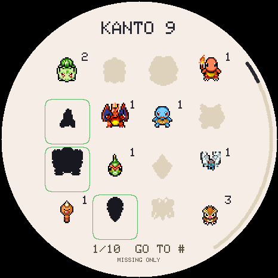 | 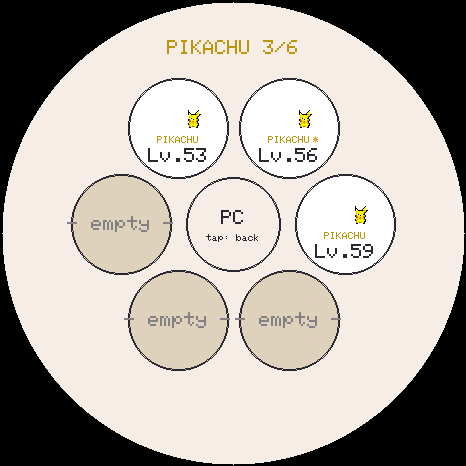 | 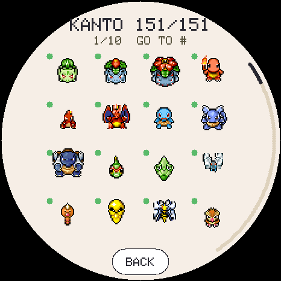 |

**Bill's PC** holds up to **six of every species**. Open it from the middle of
the party ring.

- Pick a region, and every species is a square: **in color** with a count if
  the PC holds it, **outlined** if only your party (or the one you raise) has
  it, **grey** otherwise.
- Tap a species to see its six; a Pokemon's card offers **TO PARTY** and
  **RELEASE**.
- **GO TO #** jumps to any Pokedex number. **MISSING ONLY** shows only the
  species you do not have.
- A **seventh** of one species needs a free party slot, or you choose one of the
  six to let go.

### The Pokedex

The menu's **POKEDEX**, or the POKEDEX screen, browses one region at a time.

- A species is **in color** once it has been yours: raised, held now, or a
  legendary or one-off you caught. Anything else is a silhouette.
- The **green dot** means **registered**: you raised it. Registering is what the
  Pokedex counts, and it happens when you **raise** a Pokemon, not when you catch
  it.
- **OWNED** counts the species you have right now.
- Shinies are counted separately.

### Your player card

Swipe all the way left to **PLAYER**: your trainer name (tap it to change it),
your **avatar** (tap it to choose one of 19), your **badges** (a page per
region), and your **medals**.

- **Streak:** caring for your Pokemon on consecutive days. Milestones at 3, 7,
  30 and 100 days. Missing a day breaks it.
- **Bond:** how close you are to this Pokemon, from 0 to 100. Petting, favorite
  berries and the joy games raise it, at most **20 a day**; neglect cools it.
- **Medals:** level 10, 25 and 50, favorite berry found, a 7-day streak, max
  bond, final form, and "fit" (fitness 80 or more with no care mistakes).
- A strong streak and bond make the **next** egg better: rarer, likelier to be
  shiny, and with higher IVs.

## 11. Money and the Poke Mart

- **Walking earns money: $1 a step**, up to $999,999. The board counts your
  steps while you carry it.
- **Trainer wins pay** too (chapter 9). Wild battles and LAN battles pay
  nothing.

### Buying and selling

| The Mart | Buying |
|---|---|
| 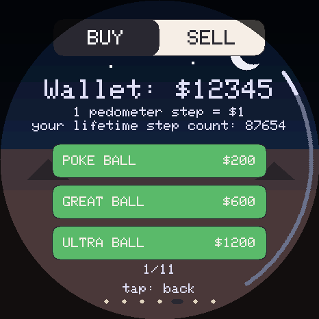 | 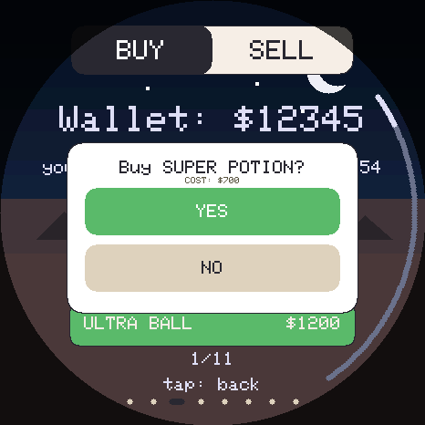 |

Swipe to **MART**. Tap **BUY** or **SELL** at the top.

- **Buy:** balls, potions, vitamins, stones, X items, the Linking Cord and
  PP Up. Prices are in [Appendix B](#appendix-b-quick-reference).
- **TMs:** the Mart sells **five TMs a day**, a different five each day. A TM
  you own is never offered again.
- **Sell:** the Mart buys anything it sells for **half the price**. It does not
  buy what it never sells (the Master Ball, Ether, PP Max, Bottle Cap).

### Using items

Open the **BAG** from the menu.

| Item | How to use it |
|---|---|
| **Vitamins** | +10 training. With a party, the bag asks who gets it. |
| **Stones** | Use on the Pokemon you are raising to evolve it. |
| **Linking Cord** | Marks the Pokemon you are raising to evolve as if traded. Kept if it would do nothing. |
| **PP Up** | Pick a Pokemon and a move: that move gets a fifth more PP, up to three times. It stays with the Pokemon. |
| **PP Max** | Fills every PP Up a move still has room for, at once. |
| **Ether** | 10 PP back to one move. |
| **Bottle Cap** | Raises one IV of your choice to 31. |
| **Balls, potions, Full Heal, X items** | In battle only, from the battle's BAG. |

A Pokemon in Bill's PC must come out to the party first.

## 12. Playing with friends

Two boards talk to each other over the air, no router needed. Both go to the
**PLAZA** (swipe all the way right).

### LAN battles

Tap **LAN BATTLE** on both boards, then **HOST BATTLE** on one and **JOIN
BATTLE** on the other, and pick your teams. There is no level or team limit.

- Your **record against each rival** is kept and shown when you pair up.
- Each player picks their own next Pokemon after a faint.
- No items, and no free switch when the rival's Pokemon faints.
- **Running is a forfeit** and counts as a loss. If your rival stops answering,
  **QUIT** appears after a while and does not count.
- PP is counted during the fight, but your saved PP is not touched.

### Trading

| The PLAZA | Choosing | A dropped connection |
|---|---|---|
| 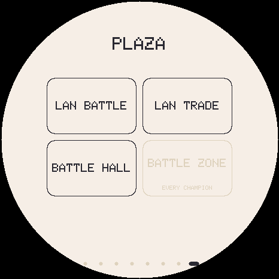 | 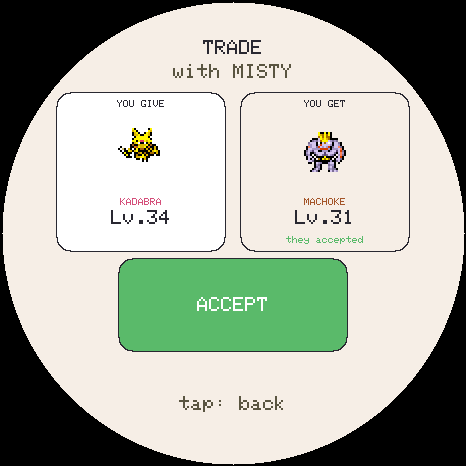 | 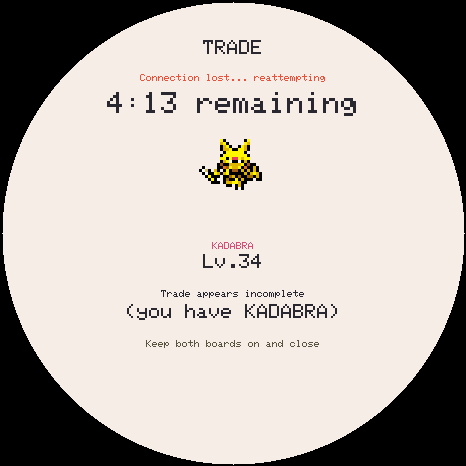 |

Tap **LAN TRADE** on both boards. They find each other.

1. Tap **YOU GIVE** and choose from your party, or from **Bill's PC** (the
   middle of the ring). Each Pokemon's card shows first: **TRADE** offers it,
   **BACK** goes back.
2. Your friend's offer appears under **YOU GET**.
3. Both tap **ACCEPT**. Changing either offer cancels both acceptances.

- You cannot trade the Pokemon you are raising.
- A Pokemon that evolves by trade arrives marked and evolves the next time you
  raise it.
- **Keep both boards close and switched on** until it finishes. If the
  connection drops, nothing is lost or copied: both boards keep trying for 5
  minutes. After that, each screen says what that board holds. Look at your
  friend's screen: if it says **complete**, choose **KEEP**; if it says
  **incomplete**, choose **REVERT**.

## 13. The Battle Hall

| The Hall |
|---|
| 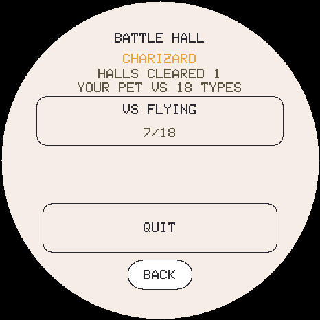 |

On the **PLAZA**, open to everyone. Your Pokemon alone, one on one, against one
Pokemon of **each of the 18 types**.

- **Your worst matchups come first**, while the opponents are weakest; the
  types your Pokemon beats come last, when they are strongest.
- Opponents start 3 levels below yours and reach your level at the 18th.
- **Each battle costs 6 energy.** When your Pokemon is tired, let it rest; the
  run waits for you.
- It uses your Pokemon's real PP, so a nap between battles refills it. No items.
- Each win pays a little money. A loss ends the run, with no blackout.
- **Clear all 18** and your Pokemon is a **HALL CHAMPION**, shown on its card
  for good, even after trades.
- Changing the Pokemon you are raising ends the run.

## 14. The Battle Zone

| The zone | The gauntlet's rules | The tournament |
|---|---|---|
| 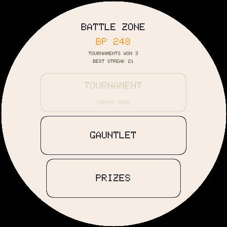 | 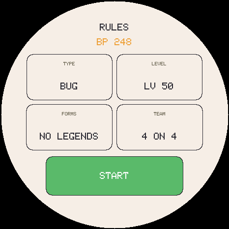 | 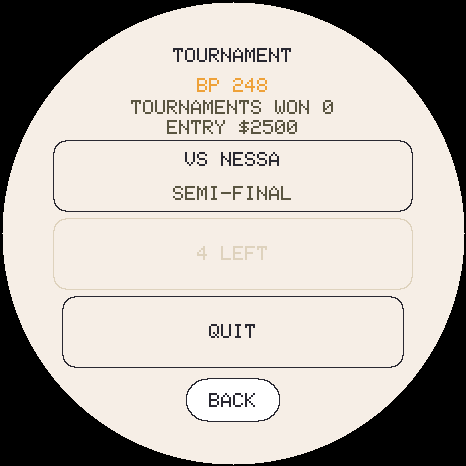 |

On the **PLAZA**, once you have beaten **every region's champion** (easy or
hard). It pays **Battle Points (BP)**.

- **The tournament** ($2,500 to enter): 16 trainers from every region, four
  rounds. Opponents bring full teams at level 100, as many as you bring. PP
  carries through the whole tournament.
- **The gauntlet** ($1,500 to enter): challengers one after another until you
  lose. Set the rules (a type, a level cap, which forms, team size) or take the
  **DAILY** rules: the first daily run that wins a battle each day earns
  **double BP** for the rest of that run. **Every 20th challenger is a boss.**
- Both pay **3 BP a win**; a boss pays 10 more and the tournament title 10 more.
- **PP carries** from battle to battle and HP is full every fight. **No bag.**
- **The prize counter** sells items for BP, including **PP Max** and the
  **Bottle Cap** (sold nowhere else), the ten **signature-move TMs**, and five
  more TMs a day.
- Your runs are saved between battles. A power cut mid-battle counts as a loss.

## 15. Settings and keeping your save safe

### Settings

Tap the name at the top, then **SETTINGS**:

- **Sound** on or off, and the **volume**.
- **Language**: English, Spanish, French, German, Italian or Portuguese.
- **SET TIME**: the hour, the minute and the **day of the week** (tap the right
  side for the next day, the left for the one before).

### Backing up

- On the [web installer](https://codester00.github.io/TamaPokeLAN/web/), **Back
  up, then install** saves your game to a `.tpsave` file before installing.
  Keep that file somewhere safe: it is your real backup.
- The installer also keeps your last 12 backups in that browser, as a
  convenience. They are lost if you clear the browser's data.
- The installer can **restore** a backup file to a board.

### Common problems

| Problem | Fix |
|---|---|
| Black screen after installing | Hold PWR about 10 seconds, then press it again. |
| Pokemon show as numbers | That region's sprite pack is missing. Add it from the installer. |
| A red warning triangle beside the battery | Saving has stopped working. Back up from the installer straight away. |
| A region is greyed out | Its sprite pack is not on the card. |
| Day and night are wrong | Set the clock under SETTINGS > SET TIME. |

---

# Part 2: Walkthrough and Strategy

## The walkthrough, region by region

Each region has its own chapter: every area in the order its badges open it,
with every Pokemon, its levels and its chances, then each leader's team,
moves, weaknesses and the Pokemon you can catch before the fight.

<!-- BEGIN GENERATED: regions -->
| Region | Areas | Ladder | Chapter |
|---|---|---|---|
| Kanto | 36 | Brock to Rival | [Kanto](players-guide/kanto.md) |
| Johto | 35 | Falkner to Lance | [Johto](players-guide/johto.md) |
| Hoenn | 43 | Roxanne to Wallace | [Hoenn](players-guide/hoenn.md) |
| Sinnoh | 54 | Roark to Cynthia | [Sinnoh](players-guide/sinnoh.md) |
| Unova | 43 | Cheren to Iris | [Unova](players-guide/unova.md) |
| Kalos | 30 | Viola to Diantha | [Kalos](players-guide/kalos.md) |
| Alola | 54 | Ilima to Kukui | [Alola](players-guide/alola.md) |
| Galar | 39 | Milo to Leon | [Galar](players-guide/galar.md) |
| Paldea | 32 | Katy to Geeta | [Paldea](players-guide/paldea.md) |
<!-- END GENERATED: regions -->

How to read a leader's advice: **Hit them with** lists the types that hurt most
of their team. **Their attacks are** the types of their damaging moves.
**Careful with** names the types those attacks hit hard. The suggestions are
worked out from the types; a well-trained team of the right types is what wins.

## Your first week

A plan for a new player. Your Pokemon grows a level an hour, so a week is a
whole life and the start of the next.

**Day 1.** Pick your region and starter, hatch it, and set the clock. Feed it,
bathe it and play until all four needs are 90 or more. Then play the training
games a few times a day, and try the joy games when petting stops working.
Explore the first areas on easy and catch one of each Pokemon you meet.

**Day 1, evening.** Your starter is about level 12. Fight the first leader on
easy. The level limit means you fight at the leader's level, so a team of
three or four caught Pokemon of the right type helps a lot.

**Days 2 and 3.** Take the next badges as their leaders' levels come within
reach. Each badge opens new areas. Walk with the board for money, and buy
**Great Balls** and a **stone** or two for the evolutions you want.

**Day 3.** Your Pokemon reaches level 73 and is offered its **farewell** once it
is in its final form. Saying goodbye blesses the next egg and puts it in your
party. Or keep it to reach level 100 first.

**Days 4 to 7.** Raise the next egg. Swap party members in with **RAISE THIS
ONE** to level and train them for the later gyms. Aim for the eighth badge and
the League.

> **PRO TIP:** Catch first, raise later. A Pokemon you catch keeps its level
> until you raise it, so catch a wide team early, and raise the ones the next
> leaders are weak to.

## How to get every Pokemon

Every species has a row in **[How to get every Pokemon](players-guide/every-pokemon.md)**:
the best wild area for it and its chance there, the egg tier it hatches in, what
it evolves from and how, and any legendary meeting, one-off, swarm or prize.

The routes, in short:

- **Eggs** give every base form except the story legendaries, from eggs of its
  own region. The egg favors lines you have not finished.
- **The wild** has most species somewhere in Explore. A species no area offers
  usually comes from an egg or an evolution.
- **Evolution** gives every other form. Stone and trade evolutions need their
  item or a Linking Cord.
- **Legendaries** with a home are met only in Explore.
- **Prizes** from the Game Corners: Abra, Clefairy, Dratini, Scyther, Pinsir and
  Porygon at Celadon; Abra, Ekans, Sandshrew and Dratini at Goldenrod.

### Evolutions that are easy to miss

| Pokemon | How |
|---|---|
| Slowking | A Linking Cord on a Slowpoke. At level 37 it becomes Slowbro instead. |
| Politoed | A Linking Cord on a Poliwhirl. Otherwise it becomes Poliwrath at its level. |
| Scizor or Kleavor | Scyther: a Linking Cord for Scizor, the Black Augurite for Kleavor. Whichever comes first. |
| Melmetal | Walk 10,000 steps while raising a Meltan. |
| Shedinja | Have a spare Poke Ball and room when Nincada evolves. |
| Gallade and Froslass | The Dawn Stone on a male Kirlia or a female Snorunt. |
| Solgaleo or Lunala | Cosmoem becomes whichever of the two you do not own yet. |
| Espeon, Umbreon, Sylveon | Eevee with bond 40 and two days old: day, night, or knowing a Fairy move. |
| Karrablast and Shelmet | Trade them for each other, or use a Linking Cord with the other in your party. |

## Raising a strong Pokemon

**IVs set the ceiling.** A Pokemon's IVs (8 to 31) add up to about 15% between
a poor one and a great one, and they cap its training. For a hard-mode team,
prefer Pokemon with high IVs, shown on the card's battle page. A **Bottle Cap**
raises one IV to 31.

**Training fills the gap.** Three stats at 100 is 300 training points: about
17 full sessions. Two-stat games pay the same total as one-stat games, so play
whichever you like best. Each full session costs 12 energy, so a nap every few
sessions keeps you going.

**A daily routine:**

1. Morning: feed, bathe, play a joy game until all needs are 90 or more. That
   starts the 8 hours.
2. Two or three training sessions, then a nap to refill energy (and PP).
3. Evening: top up again, train, and put it to bed after 18:00.

**Evolve when it suits you.** A Pokemon is usually stronger evolved, but each
form learns different moves at different levels. Keep form if a move is coming
soon, then evolve.

**PP decides long fights.** For the League, the gauntlet and the tournament, put
**PP Ups** on your strongest moves and carry **Ethers**.

**Build a team that covers each other.** Six Pokemon of different types with
different attacking moves beat six strong Pokemon of one type. Check each
leader's weaknesses in the region chapters.

> **PRO TIP:** Vitamins work on party members, so a team can be trained without
> swapping each one in. Raising a Pokemon also levels it; a party member stays
> at its level until you raise it again.

## Spending money well

**Early game** (the first three badges):

- **Poke Balls and Great Balls**: enough to catch a team.
- **The stone** for an evolution you want, at $2,100.
- Sell stones and vitamins you will not use (half price).

**Mid game:**

- **TMs** from the Mart's daily five: one strong attack of each type you use.
- **A Linking Cord** ($9,800) for a trade evolution you want.
- **Vitamins** ($9,800 each, +10 training) only if you cannot play the training
  games. The games are free.

**Late game:**

- **PP Up** ($10,000) on your best moves before the League.
- **X items** to turn a hard fight.
- **Gym rematches** for money: every win pays, hard pays double, and a rematch
  pays half the first win. The champions pay the most.

> **PRO TIP:** Walking is the steadiest income. A 5,000-step day is $5,000, and
> it adds up while you do everything else.

## Where to find every TM

Every TM, its type, power, price and where else it comes from is in
**[Every TM](players-guide/tms.md)**. In short:

- **The Mart:** five TMs a day, a different five each day. Status TMs cost
  $2,000; attacks cost 40 × their power, from $1,500 to $5,000.
- **Wild wins:** 5% of easy wins and 8% of hard wins drop a TM you do not own.
- **The Game Corners:** Surf, Ice Beam, Thunderbolt, Flamethrower, Shadow Ball
  and Iron Tail at Celadon; Thunder, Blizzard and Fire Blast at Goldenrod.
- **The Battle Zone counter:** five more a day for BP, and the ten
  **signature-move TMs** (Roar of Time, Shadow Force, Blue Flare, Bolt Strike,
  Blast Burn and the rest), each for its own Pokemon only.

## The Safari Zones

**The short version:** in Kanto, throw balls; use bait only on Chansey and
Dratini. In Hoenn, throw one **Pokeblock** first at the hard-to-catch ones,
and never GO NEAR more than once. In the Great Marsh, just throw balls.

The table below is measured with the game's own Safari rules, 20,000
encounters per pattern. It shows each Pokemon's chance of being caught in one
encounter (30 Safari Balls) by throwing only balls, and the best pattern when
another one does better.

<!-- BEGIN GENERATED: safari -->
**SAFARI ZONE** (Kanto)

| Pokemon | Balls only | Best pattern | Its odds |
|---|---|---|---|
| Chansey | 10% | Bait, then balls; bait again when it stops eating | 16% |
| Pinsir | 16% | Balls only | 16% |
| Scyther | 16% | Balls only | 16% |
| Kangaskhan | 16% | Balls only | 16% |
| Tauros | 16% | Balls only | 16% |
| Dragonair | 16% | Balls only | 16% |
| Dratini | 20% | Bait, then balls; bait again when it stops eating | 24% |
| Seaking | 33% | Balls only | 33% |
| Parasect | 36% | Balls only | 36% |
| Venomoth | 36% | Balls only | 36% |
| Exeggcute | 49% | Balls only | 49% |
| Nidorino | 54% | Balls only | 54% |
| Rhyhorn | 55% | Balls only | 55% |
| Nidorina | 55% | Balls only | 55% |
| Doduo | 82% | Balls only | 82% |
| Psyduck | 82% | Balls only | 82% |
| Paras | 82% | Balls only | 82% |
| Venonat | 82% | Balls only | 82% |
| Slowpoke | 83% | Balls only | 83% |
| Nidoran (male) | 87% | Balls only | 87% |
| Nidoran (female) | 87% | Balls only | 87% |
| Goldeen | 87% | Balls only | 87% |

**SAFARI ZONE** (Hoenn)

| Pokemon | Balls only | Best pattern | Its odds |
|---|---|---|---|
| Wobbuffet | 37% | One Pokeblock, then balls | 53% |
| Dodrio | 37% | One Pokeblock, then balls | 54% |
| Pinsir | 37% | One Pokeblock, then balls | 53% |
| Heracross | 37% | One Pokeblock, then balls | 53% |
| Girafarig | 44% | One Pokeblock, then balls | 59% |
| Seaking | 44% | One Pokeblock, then balls | 59% |
| Xatu | 48% | One Pokeblock, then balls | 62% |
| Golduck | 49% | One Pokeblock, then balls | 63% |
| Gloom | 67% | One Pokeblock, then balls | 73% |
| Phanpy | 67% | One Pokeblock, then balls | 73% |
| Rhyhorn | 67% | One Pokeblock, then balls | 73% |
| Psyduck | 82% | Balls only | 82% |
| Pikachu | 82% | Balls only | 82% |
| Natu | 82% | Balls only | 82% |
| Doduo | 82% | Balls only | 82% |
| Oddish | 87% | Balls only | 87% |
| Goldeen | 87% | Balls only | 87% |
| Geodude | 87% | Balls only | 87% |

**SAFARI EXTENSION** (Hoenn)

| Pokemon | Balls only | Best pattern | Its odds |
|---|---|---|---|
| Miltank | 37% | One Pokeblock, then balls | 53% |
| Aipom | 37% | One Pokeblock, then balls | 53% |
| Stantler | 37% | One Pokeblock, then balls | 53% |
| Gligar | 44% | One Pokeblock, then balls | 60% |
| Octillery | 48% | One Pokeblock, then balls | 63% |
| Quagsire | 62% | One Pokeblock, then balls | 70% |
| Houndour | 66% | One Pokeblock, then balls | 73% |
| Teddiursa | 67% | One Pokeblock, then balls | 72% |
| Remoraid | 82% | Balls only | 82% |
| Pineco | 82% | Balls only | 82% |
| Marill | 82% | Balls only | 82% |
| Shuckle | 82% | Balls only | 82% |
| Snubbull | 83% | Balls only | 83% |
| Sunkern | 87% | Balls only | 87% |
| Mareep | 87% | Balls only | 87% |
| Goldeen | 87% | Balls only | 87% |
| Wooper | 87% | Balls only | 87% |
| Hoothoot | 87% | Balls only | 87% |
| Ledyba | 87% | Balls only | 87% |
| Spinarak | 87% | Balls only | 87% |

**GREAT MARSH** (Sinnoh)

| Pokemon | Balls only | Best pattern | Its odds |
|---|---|---|---|
| Tangela | 22% | Balls only | 22% |
| Yanma | 30% | Balls only | 30% |
| Gyarados | 30% | Balls only | 30% |
| Quagsire | 51% | Balls only | 51% |
| Noctowl | 51% | Balls only | 51% |
| Bibarel | 62% | Balls only | 62% |
| Wooper | 69% | Balls only | 69% |
| Hoothoot | 74% | Balls only | 74% |
| Tropius | 74% | Balls only | 74% |
| Carvanha | 74% | Balls only | 74% |
| Whiscash | 98% | Balls only | 98% |
<!-- END GENERATED: safari -->

## The side games

### Slots

Both Game Corners have slots: Red's machines at Celadon, Crystal's at
Goldenrod. Bet 1 to 3 coins (more lines), SPIN, then STOP each reel.

- **Celadon:** wins come about 1 spin in 10 at 1 coin, 1 in 3 at 3 coins.
  Every so often a machine gets into a mood for 7s and BARs and stays that way
  until one pays. One machine is **lucky** each time you walk in.
- **Goldenrod:** stingy on 1 coin (1 win in 30), much better at 2 or 3 coins.
  About 1 sitting in 5 is at a lucky machine.
- **Both pay out more than they take** over a long session, as the originals
  did: about two coins back per coin, mostly in streaks.

> **PRO TIP:** Bet 3 coins. If a machine has gone cold for a long time, back out
> and sit down again for a different machine.

### Card flip (Goldenrod)

24 cards: four Pokemon, each numbered 1 to 6. Guess the Pokemon, the number or
both, then FLIP. 3 coins a flip pays 12 for the Pokemon, 18 for the number, 72
for both. The odds are exactly fair, so it is the steady way to turn coins into
a long game. Watch **CARDS LEFT**: the deck is not reshuffled until it runs
down, so late in the deck the cards already seen tell you what is left.

### Prizes

| Celadon | Coins | Goldenrod | Coins |
|---|---|---|---|
| Abra (level 9) | 180 | Abra (level 5) | 200 |
| Clefairy (level 8) | 500 | Ekans (level 5) | 700 |
| Pinsir (level 18) | 2,500 | Sandshrew (level 5) | 700 |
| Dratini (level 18) | 2,800 | Dratini (level 10) | 2,100 |
| Scyther (level 25) | 5,500 | TM Thunder, Blizzard, Fire Blast | 5,500 each |
| Porygon (level 26) | 9,999 | | |
| TM Iron Tail | 3,500 | | |
| TM Surf, Ice Beam, Thunderbolt, Flamethrower | 4,000 each | | |
| TM Shadow Ball | 4,500 | | |

Coins cost **$1,000 for 50**, up to 9,999 coins.

### Surfing Pikachu

There is a secret on the Kanto coast for a Pikachu that can ride the waves.
Once you find it: hold the **left** side to lean forward and the **right** side
to lean back (or tilt the board). Lean down the face of a wave and back up the
next to build speed; fast over a crest, Pikachu jumps. In the air, rock the
board side to side for tricks, and land level. It pays coins, joy and bond.

### Training game scores

- **Rock Smash:** watch the ring, not the rock. A perfect tap is within about
  a tenth of a second.
- **Block!:** do not tap sides with nothing coming: the shield wobbles.
- **Boulder Push:** wait for the green. A miss slips the boulder back.
- **Tilt Maze:** hold the board level when it starts: that angle counts as
  level.

## The post-game

### The Battle Hall

- **Raise its IVs.** Opponents never have perfect IVs, so a Pokemon with 31s
  has a real edge. Use **Bottle Caps**.
- **Train it fully** and give it moves of several types: the early opponents
  are your worst matchups.
- **Strong species clear far more often.** A well-trained Pokemon with average
  IVs clears about one run in ten.
- **Energy:** each battle costs 6. Rest between sittings; the run waits.

### The gauntlet

- **PP is the limit.** HP comes back every fight but PP does not, so put **PP
  Ups** on your strongest moves. They are what take a good team past the first
  boss.
- **The first challengers are easy.** The challengers get stronger every round,
  and every 20th is a fully trained boss.
- **Play the daily run first** each day: its first win doubles the BP for the
  whole run.
- **The level cap locks out** Pokemon above it. Raise a second team for level 50
  rules.

### The tournament

- A full, strong team of six wins almost every time. Bring six.
- Opponents bring as many as you, at level 100, so a small team does not make
  it easier.
- It is the quick way to turn money into BP.

### Spending BP

<!-- BEGIN GENERATED: zone -->
| Prize | BP |
|---|---|
| Master Ball | 800 |
| Pp Up | 45 |
| Pp Max | 120 |
| Bottle Cap | 120 |
| Ether | 4 |
| Protein | 40 |
| Iron | 40 |
| Carbos | 40 |
| Linking Cord | 40 |
| Fire Stone | 10 |
| Water Stone | 10 |
| Thunderstone | 10 |
| Leaf Stone | 10 |
| Moon Stone | 10 |
| Sun Stone | 10 |
| Shiny Stone | 10 |
| Dusk Stone | 10 |
| Dawn Stone | 10 |
| Ice Stone | 10 |
| Black Augurite | 14 |
| A signature-move TM | 48 or 32 |
| One of the day's five TMs | the Mart price / 250 |
<!-- END GENERATED: zone -->

**First buys:** PP Max for your best moves, then Bottle Caps for the Battle
Hall. The Master Ball (800 BP) is for the one legendary that keeps fleeing.

---

# Appendices

## Appendix A: Type chart

<!-- BEGIN GENERATED: typechart -->
Rows attack, columns defend. **2** = super effective (double), **½** = not very effective (half), **0** = no effect, blank = normal.

| ATK \ DEF | NOR | FIR | WAT | ELE | GRA | ICE | FIG | POI | GRO | FLY | PSY | BUG | ROC | GHO | DRA | DAR | STE | FAI |
|---|---|---|---|---|---|---|---|---|---|---|---|---|---|---|---|---|---|---|
| **Normal** |  |  |  |  |  |  |  |  |  |  |  |  | ½ | 0 |  |  | ½ |  |
| **Fire** |  | ½ | ½ |  | **2** | **2** |  |  |  |  |  | **2** | ½ |  | ½ |  | **2** |  |
| **Water** |  | **2** | ½ |  | ½ |  |  |  | **2** |  |  |  | **2** |  | ½ |  |  |  |
| **Electric** |  |  | **2** | ½ | ½ |  |  |  | 0 | **2** |  |  |  |  | ½ |  |  |  |
| **Grass** |  | ½ | **2** |  | ½ |  |  | ½ | **2** | ½ |  | ½ | **2** |  | ½ |  | ½ |  |
| **Ice** |  | ½ | ½ |  | **2** | ½ |  |  | **2** | **2** |  |  |  |  | **2** |  | ½ |  |
| **Fighting** | **2** |  |  |  |  | **2** |  | ½ |  | ½ | ½ | ½ | **2** | 0 |  | **2** | **2** | ½ |
| **Poison** |  |  |  |  | **2** |  |  | ½ | ½ |  |  |  | ½ | ½ |  |  | 0 | **2** |
| **Ground** |  | **2** |  | **2** | ½ |  |  | **2** |  | 0 |  | ½ | **2** |  |  |  | **2** |  |
| **Flying** |  |  |  | ½ | **2** |  | **2** |  |  |  |  | **2** | ½ |  |  |  | ½ |  |
| **Psychic** |  |  |  |  |  |  | **2** | **2** |  |  | ½ |  |  |  |  | 0 | ½ |  |
| **Bug** |  | ½ |  |  | **2** |  | ½ | ½ |  | ½ | **2** |  |  | ½ |  | **2** | ½ | ½ |
| **Rock** |  | **2** |  |  |  | **2** | ½ |  | ½ | **2** |  | **2** |  |  |  |  | ½ |  |
| **Ghost** | 0 |  |  |  |  |  |  |  |  |  | **2** |  |  | **2** |  | ½ |  |  |
| **Dragon** |  |  |  |  |  |  |  |  |  |  |  |  |  |  | **2** |  | ½ | 0 |
| **Dark** |  |  |  |  |  |  | ½ |  |  |  | **2** |  |  | **2** |  | ½ |  | ½ |
| **Steel** |  | ½ | ½ | ½ |  | **2** |  |  |  |  |  |  | **2** |  |  |  | ½ | **2** |
| **Fairy** |  | ½ |  |  |  |  | **2** | ½ |  |  |  |  |  |  | **2** | **2** | ½ |  |
<!-- END GENERATED: typechart -->

## Appendix B: Quick reference

### The Poke Mart

<!-- BEGIN GENERATED: mart -->
| Item | Buy | Sell | What it does |
|---|---|---|---|
| Poke Ball | $200 | $100 | catch rate x1 |
| Great Ball | $600 | $300 | catch rate x1.5 |
| Ultra Ball | $1,200 | $600 | catch rate x2 |
| Potion | $300 | $150 | +20 HP in battle |
| Super Potion | $700 | $350 | +50 HP in battle |
| Hyper Potion | $1,200 | $600 | +120 HP in battle |
| Full Heal | $600 | $300 | cures a status problem in battle |
| Protein | $9,800 | $4,900 | +10 Attack training |
| Iron | $9,800 | $4,900 | +10 Defense training |
| Carbos | $9,800 | $4,900 | +10 Speed training |
| Linking Cord | $9,800 | $4,900 | evolves a trade evolver without a trade |
| Fire Stone | $2,100 | $1,050 | evolves the Pokemon that need it |
| Water Stone | $2,100 | $1,050 | evolves the Pokemon that need it |
| Thunderstone | $2,100 | $1,050 | evolves the Pokemon that need it |
| Leaf Stone | $2,100 | $1,050 | evolves the Pokemon that need it |
| Moon Stone | $2,100 | $1,050 | evolves the Pokemon that need it |
| Sun Stone | $2,100 | $1,050 | evolves the Pokemon that need it |
| Shiny Stone | $2,100 | $1,050 | evolves the Pokemon that need it |
| Dusk Stone | $2,100 | $1,050 | evolves the Pokemon that need it |
| Dawn Stone | $2,100 | $1,050 | evolves the Pokemon that need it |
| Ice Stone | $2,100 | $1,050 | evolves the Pokemon that need it |
| Black Augurite | $3,000 | $1,500 | evolves the Pokemon that need it |
| X Attack | $1,000 | $500 | Attack +2 stages for the fight |
| X Defense | $2,000 | $1,000 | Defense +2 stages |
| X Sp. Atk | $1,000 | $500 | Sp. Atk +2 stages |
| X Sp. Def | $2,000 | $1,000 | Sp. Def +2 stages |
| X Speed | $1,000 | $500 | Speed +2 stages |
| Pp Up | $10,000 | $5,000 | one move gets a fifth more PP (3 times at most) |
<!-- END GENERATED: mart -->

### Wild battle drops

One item per win, a second 25% of the time (50% on hard):

<!-- BEGIN GENERATED: drops -->
| Item | Chance per item drawn |
|---|---|
| Poke Ball | 24.6% |
| Potion | 16.4% |
| Great Ball | 12.3% |
| Super Potion | 8.2% |
| Full Heal | 8.2% |
| Protein | 6.6% |
| Iron | 6.6% |
| Carbos | 6.6% |
| Ultra Ball | 4.9% |
| Hyper Potion | 3.3% |
| Ether | 1.6% |
| Master Ball | 0.8% |
<!-- END GENERATED: drops -->

### Numbers worth knowing

| | |
|---|---|
| Level | +1 an hour, up to 100 (4 days 3 hours) |
| Farewell | offered in the final form at 3 days (level 73) |
| Egg | hatches after 3 taps or 3 minutes |
| Needs fall (awake) | about 10 an hour (hygiene 7.5) |
| The 8-hour rule | all four needs at 90 or more |
| Care mistake | a need at 10 or below, after the 8 hours |
| Runaway | all needs at zero for an hour |
| Nap | 06:00 to 18:00; up when energy is full |
| Bedtime | 18:00 to 06:00; sleeps in until 08:00 |
| Evolution | every need at 40 or more |
| Training session | up to 18 points; full costs 12 energy, 5 food |
| Too tired | under 15 energy |
| Training ceiling | 70 + 30 × IV / 31 |
| Bond | at most +20 a day |
| Critical hit | 1 in 16, 1.5x damage |
| Same type bonus | 1.5x damage |
| Money | $1 a step, up to $999,999 |
| Coins | 50 for $1,000, up to 9,999 |
| TM drop | 5% of wins on easy, 8% on hard |
| Stone drop | about 1 win in 25, in stone areas |
| Wild shiny | 1 in 4,096 |
| Battle Hall | 6 energy a battle |
| Battle Zone | tournament $2,500, gauntlet $1,500; 3 BP a win |

## Appendix C: Glossary and common questions

| Word | Meaning |
|---|---|
| **IV** | A Pokemon's hidden strength in each stat, 8 to 31, fixed when it hatches. Also its training ceiling. |
| **Training** | 0 to 100 per stat, from the training games, vitamins and gym wins. |
| **PP** | How many more times a move can be used. Comes back with a full rest. |
| **Bond** | How close you are to this Pokemon, 0 to 100. |
| **Streak** | Days in a row you have cared for your Pokemon. |
| **BP** | Battle Points, the Battle Zone's currency. |
| **Registered** | A species you have raised. What the Pokedex counts. |
| **Owned** | A species you have right now. |
| **Final form** | A Pokemon that evolves no further. |
| **Care mistake** | A need at 10 or below after the 8 hours. Each delays evolution a level. |

**Why does my Pokemon show a number instead of a picture?** Its region's sprite
pack is not on the card. Add it from the web installer.

**Why can't I evolve?** Check the card: it says what it needs (a level, a stone,
a trade). Every need must be 40 or more, and care mistakes add levels.

**Why didn't my Pokemon learn its move?** With four moves it asks which to
forget. If you skipped it, swap it in from the MOVES page any time.

**Why won't it train?** Under 15 energy it is too tired. Let it nap.

**Why are my moves running out?** PP carries over between fights. A full
night's sleep or a full nap refills it.

**Can I lose a Pokemon in a trade?** No. If the connection drops, both boards
keep trying, and then you choose KEEP or REVERT by looking at your friend's
screen.

**Where is the legendary?** In its home area in Explore, once you have the badge
it needs. Its row shows a star until you have met it. See the region chapters.

**Is the Master Ball worth saving?** Yes. Save it for a legendary or a Safari
Pokemon that keeps fleeing.

                    

---

---

          

# Spoilers ahead

**Stop here if you want to find the game's secrets yourself.** Everything below
is hidden in the game on purpose.

          

## Secrets

### Secret codes

Codes are tapped in the **Memory** game, during the **watch** phase, while the
berries are still lighting up: eight taps on the berries, where 0 is the top
berry, 1 the right, 2 the bottom and 3 the left.

| Code | Taps | What it does |
|---|---|---|
| **CELADON** | 0 1 2 3 0 1 2 3 (around clockwise, twice) | Opens Celadon Game Corner for this visit |
| **GOLDENROD** | 0 3 2 1 0 3 2 1 (around anticlockwise, twice) | Opens Goldenrod Game Corner for this visit |
| **SURF** | 0 2 0 2 1 3 1 3 | Opens Surfing Pikachu for this visit |
| **ZONE** | 1 1 3 3 1 1 3 3 | Opens the Battle Zone for this visit |
| **SETTINGS** | 0 0 2 2 3 1 3 1 (up up down down left right left right) | The hidden settings |
| **CHEATS** | 2 2 0 0 1 3 1 3 (the same, upside down) | The cheats |

The four that open a place leave no mark: coins, BP and scores you earn there
are kept.

### Hidden settings

The **SETTINGS** code opens rule changes. Turning **any** of them on puts a
permanent **MODIFIED RULES** mark on your player card, even if you turn it off
again. None of them apply in LAN battles or trades.

| Setting | What it changes |
|---|---|
| No farming lockout | Every release egg keeps its legendary chance (see the hidden rules) |
| Safety net at 5 | A legendary farewell egg after 5 without one, not 10 |
| Legendary eggs | Story legendaries can hatch from eggs too |
| All in Explore | The mixed ALL region appears in Explore |
| No gym level cap | Your team fights at its own level in gyms |
| No hard team cap | Bring six against any hard leader |
| Companions grow | A companion that has stopped growing ages and evolves again |
| No daily bond cap | Bond can rise more than 20 a day |
| No runaways | A neglected Pokemon never runs away |
| Necrozma: UB met | Necrozma appears once all seven Ultra Beasts are met, not caught |
| Classic stats | Training adds its full value at every level |
| Lucky slots | Every slot machine you sit at is a lucky one |

### Cheats

The **CHEATS** code opens a list of cheats. Using **any** of them puts a
permanent **CHEATS USED** mark on your player card. A Pokemon a cheat changed
directly carries its own mark, which goes with it in trades and shows in LAN
battles. No cheat works in LAN battles or trades.

| Cheat | What it does |
|---|---|
| +1000 coins | 1,000 Game Corner coins |
| +1 Master Ball | One Master Ball |
| +100000 money | $100,000 |
| All TMs | Every TM. A move taught from a TM you only have this way marks the Pokemon |
| Unlimited PP | Your side spends no PP (a switch) |
| All badges | Every badge in every region, on both difficulties |
| All areas open | Every Explore area unlocked (a switch) |
| Meet legendary | Your next Explore encounter is a legendary of that region |
| Max training | The Pokemon you raise trains to its ceiling (marks it) |
| Hatch now | Hatches the egg (marks the Pokemon) |
| Shiny egg | The next egg hatches shiny (marks the Pokemon) |
| Re-roll day | A new weather and a new set of Mart TMs for today |

### The hidden rules

The game does not tell you these on screen.

- **The 8-hour window** is real but invisible. Nothing shows whether it is
  running, and a nap ending makes no sound.
- **The legendary safety net.** After **10 farewell eggs in a row** without a
  legendary, the next farewell egg is one, as long as your egg region still has
  a legendary you have not registered and you have 25 species registered. Only
  farewells count.
- **The farming lockout.** Releasing or retiring a Pokemon early for a quick
  egg works once: the first such egg since your last farewell keeps its normal
  legendary chance, and every one after that has **none**, until you raise a
  Pokemon to its farewell again.
- **The best fishing rod.** Fishing Pokemon in each area arrive only once the
  games would have given you their best rod: Kanto after the Rainbow Badge,
  Johto after the champion, Hoenn after the Feather Badge, Sinnoh and Unova
  after the champion, Kalos after the Fairy Badge, Alola after Lana's trial.
- **Galar's lakes.** The Wild Area's water Pokemon arrive after the Rock Badge,
  when the Rotom Bike can cross water.
- **Paldea's Orthworm** waits for its Titan, mapped to the Water Badge, and
  Area Zero's Paradox Pokemon wait for the champion.
- **Necrozma** appears only once all seven Ultra Beasts are **caught**.
- **Surfing Pikachu** opens a **SUMMER BEACH HOUSE** row in Kanto's area list,
  right after SEA ROUTES 19-21, when all four are true: the Pokemon you raise is
  a **Pikachu**, it **knows Surf** (the TM is a Celadon prize), SEA ROUTES 19-21
  is open (the Soul Badge), and **every species that area offers is registered**
  in your Pokedex.
